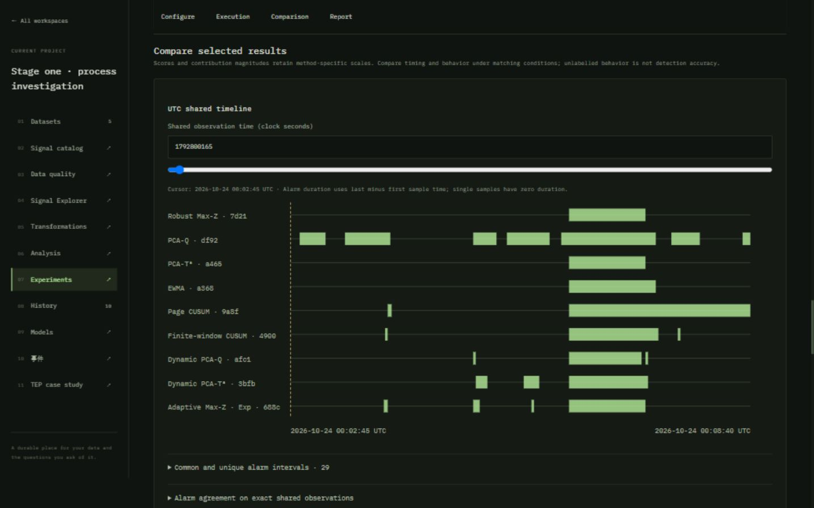
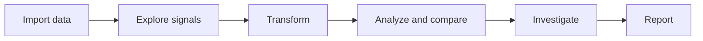
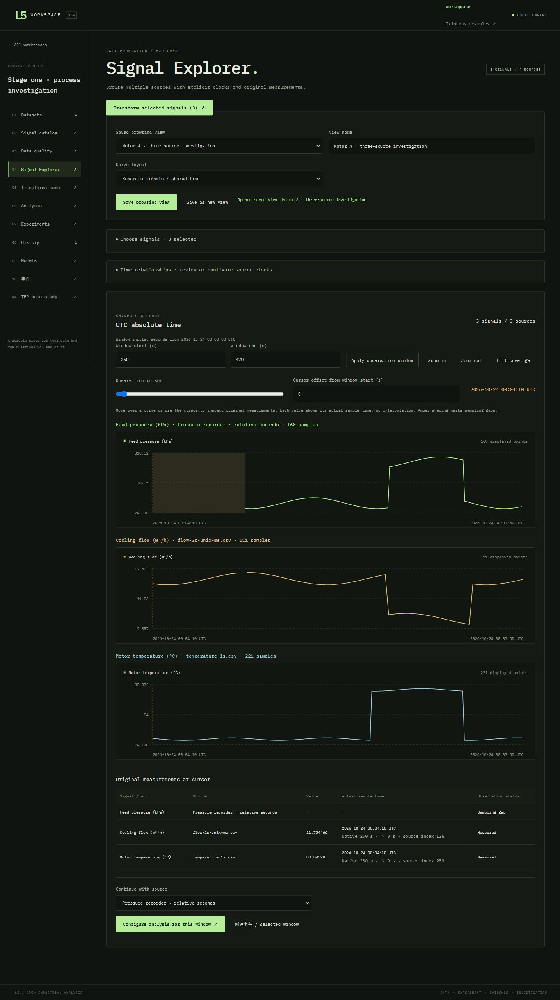
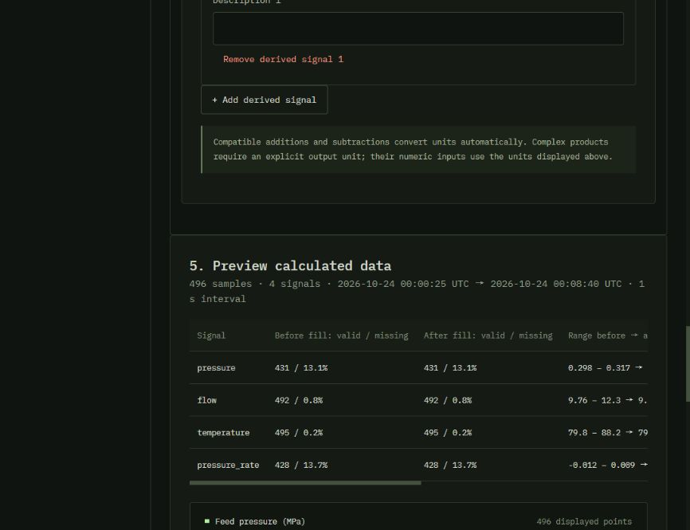
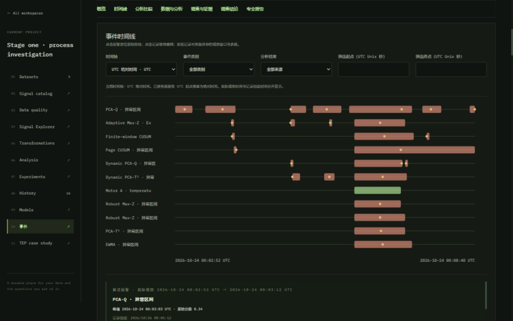
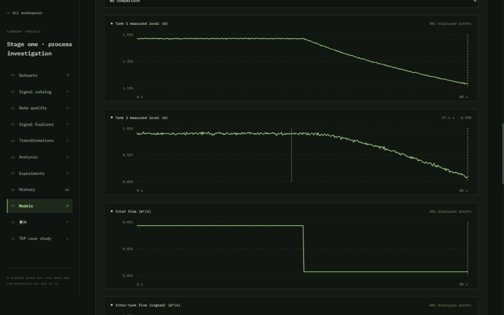
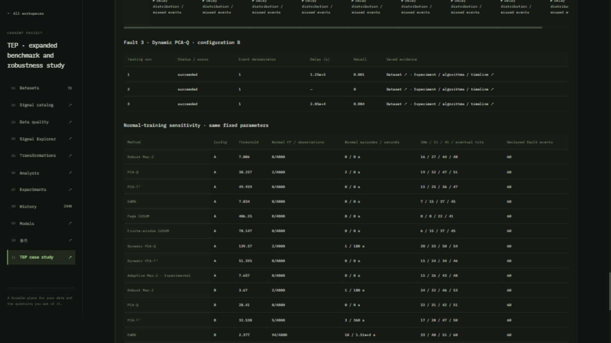

# L5 — Industrial Process Analysis & Investigation Workspace

**Industrial time-series analysis, anomaly detection, process experiments and incident investigation.**

[Quick Start](#quick-start) · [Features](#core-features) · [TEP Case Study](#tennessee-eastman-case-study) · [Architecture](docs/architecture.md) · [Documentation](#examples--documentation)

[](https://github.com/dongxuelian2/L5/actions/workflows/check.yml)

L5 keeps industrial data, processing steps, detection results and investigation evidence together in a persistent local project. Start with your own CSV, explore multiple sources, derive a dataset and compare nine detectors. Turn alarm intervals, evidence and conclusions into an incident and an offline report. TripLens and coupled-tank models provide a second complete path from fault scenarios to intervention experiments.



*Align three CSV sources into a derived dataset, compare nine detectors on a shared timeline, and link the saved results to an incident.*

## Core Features

| Module | What you can do |
|---|---|
| **Data Management** | Create persistent workspaces; import CSV/TSV; inspect samples, clocks and quality; retain multiple datasets and analysis histories. |
| **Signal Explorer** | Edit names, engineering units, devices and tags. Relate source clocks, browse raw measurements with a shared window and cursor, inspect missing samples and acquisition gaps, and save views. |
| **Data Transformation** | Convert units, resample, handle duplicate timestamps and missing values, and calculate derived signals. Preview computed curves and sample provenance, then generate an ordinary analysis-ready Dataset. |
| **Anomaly Detection** | Run Robust Max-Z, PCA-Q/T², EWMA, Page CUSUM, finite-window CUSUM, DPCA-Q/T² and Adaptive Max-Z (Experimental). Inspect scores, thresholds, intervals and signal contributions. |
| **Experiment & Benchmark** | Compare algorithms and finite parameter studies; configure separate normal fit, calibration and test datasets; retain execution snapshots, task status, label evaluations, research notes and conclusions. |
| **Incident Investigation** | Organize datasets, analyses and intervals into an incident. Connect timelines, raw curves, hypotheses and supporting or opposing evidence, then return to the saved sources. |
| **Models & Scenarios** | Create versioned scenarios, simulate faults, run investigation tools and compare interventions. TripLens provides 18 signals and 12 faults; Coupled-Tank provides 7 signals and 4 faults. |
| **Reporting & Export** | Generate standalone HTML containing saved curves, provenance, parameters and conclusions. Print to A4 PDF in the browser, export analysis/incident JSON, and download simulated observations as CSV. |

## Workflows & Screenshots



**Multiple sources → derived Dataset.** Make time relationships and units explicit while retaining original observations and processing provenance.

<details>
<summary>Signal Explorer: three sources, one observation window and a raw-sample cursor</summary>



</details>

<details>
<summary>Transformation: resampling, unit conversion and measured quality preview</summary>



</details>

**Detection results → investigation records.** Place detector alarms, published events and observations on one timeline, then link evidence and generate a report.



**Model scenario → intervention comparison → Dataset → Experiment.** Save each simulation with its configuration and continue with the same data, analysis and investigation tools.

<details>
<summary>Coupled-Tank: measured levels and inlet flow under pump degradation</summary>



</details>

[More screenshots and example data](docs/images/README.md).

## Tennessee Eastman Case Study

L5 brings [Rieth et al.'s official public TEP simulation data](https://doi.org/10.7910/DVN/6C3JR1) into the Dataset → Experiment → Incident workflow: **52 process variables, nine detectors, 20 faults and three normal-training configurations**.

The expanded benchmark completed **585 executions**, and the A/B/C normal-training study completed **1,755 executions**: **2,340 successful executions** across both studies, covering **1,755 distinct training-configuration/detector/test-run combinations**. Training configuration A was evaluated in both studies.

| Fixed configuration A | Detected within 30 min / 60 fault events | Eventual nominal detections / 60 | Alarm samples on normal data / 4,800 |
|---|---:|---:|---:|
| PCA-Q | 19 | 51 | 2 |
| DPCA-Q | 20 | 54 | 2 |

On the same normal test data, Page CUSUM produced **0, 739 and 1,833** alarm samples under training configurations A, B and C. The study reports early detections, eventual alarm overlap, detection delay and normal-data alarm burden separately. See the [expanded benchmark](docs/tep-benchmark-expanded.md) for the full nine-detector results and per-fault analysis.



Results use TEP mode 1 and three test runs per fault. [Original 72-task case](docs/tep-case-study.md) · [Data preparation and reproduction](examples/tep/README.md)

## Quick Start

Install **Node.js 20.19+ or 22.12+, npm and Python 3.12+**. From the repository root:

```bash
npm ci
python -m venv .venv
node scripts/python.mjs -m pip install -r requirements.txt
npm run build
npm run serve
```

Open **http://127.0.0.1:8787**, create a workspace and import a CSV. The repository includes [three signal examples](examples/data-foundation/README.md). The default engine runs locally; prepare official TEP data separately using the [reproduction guide](examples/tep/README.md).

The interface supports English and Chinese, with a language switch in the top-right corner. Your selection also applies to newly generated offline reports.

For development, run `npm run serve` and `npm run dev` in separate terminals. Vite proxies `/api` to port 8787. The Python launcher prefers the project `.venv`; set `PYTHON` to select another interpreter.

Projects live in `data/` by default: SQLite stores metadata and investigation records; CSV, NumPy arrays and result files retain numerical evidence. Restart with the same directory to continue. Set `L5_DATA_DIR` or choose a directory explicitly:

```bash
node scripts/python.mjs server.py --data-dir /path/to/l5-data
```

## Examples & Documentation

| Start here | Further details |
|---|---|
| [User guide: data, signals and transformations](docs/user-guide.md#数据与信号) | [Signal and clock contracts](docs/architecture.md#signal--time-series-workspace) · [Transformations](docs/architecture.md#transformation-pipeline) |
| [Analysis and experiments](docs/user-guide.md#分析与实验) | [Configuration, labels, evaluation and API](docs/architecture.md#analysis-experiments) |
| [Models and scenarios](docs/user-guide.md#模型与场景) | [Model interfaces, equations, numerical examples and limits](docs/model-workspace.md) |
| [Incidents and reports](docs/user-guide.md#事件与报告) | [Timeline, reports and persistence](docs/architecture.md#事件时间线共享窗口与报告) |
| [Original TEP case](docs/tep-case-study.md) · [Expanded benchmark](docs/tep-benchmark-expanded.md) | [Reproduction and result files](examples/tep/README.md) · [Earlier algorithm studies](benchmarks/README.md) |
| [TripLens example video](video/README.md) | Open **TripLens examples** in the application for the existing investigation and teaching cases. |

## Development & Validation

React 19, TypeScript and Vite power the frontend; Python 3.12+, NumPy, pandas and SQLite provide local computation and persistence. GitHub Actions builds the application on pushes to `main`. Run the application and research checks locally:

```bash
npm run check             # Workspace/simulation Python, React DOM, TypeScript, production build
npm run test:research     # Research regressions
```

[Development notes](docs/development.md) · [Research methods and limitations](benchmarks/README.md) · [MIT License](LICENSE)
