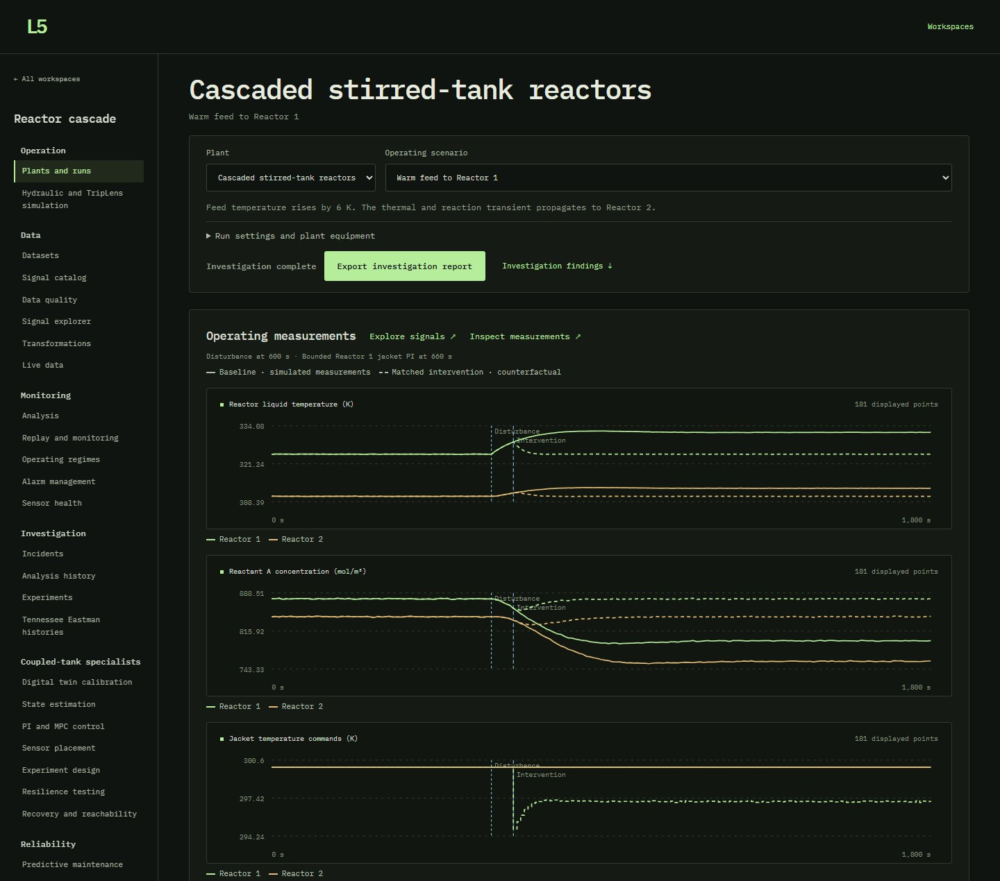

# L5

**Industrial process analysis, simulation, and investigation in a local workstation.**

Open a workspace, select **Tennessee Eastman** or **Cascaded stirred-tank reactors**, then choose an operating scenario. **Run investigation** starts the plant and saves measurements, detection, a matched intervention and an incident. **Export investigation report** downloads the linked evidence as standalone HTML.

The [industrial process guide](docs/industrial-process.md) documents the equations, supported operating points, reference comparisons and intervention results.



## Quick start

Use **Node.js 22.12+**, **npm**, and **Python 3.12+**. Tennessee Eastman also requires GNU Fortran on PATH. From the repository root:

```sh
npm ci
python3 -m venv .venv
node scripts/python.mjs -m pip install -r requirements.txt
npm run build
npm run serve
```

On Windows, create the environment with `py -3.12 -m venv .venv`. The remaining commands use the same Node.js entry points.

Open **[http://127.0.0.1:8787](http://127.0.0.1:8787)** and create or open a workspace. **Plants and runs** opens first. Choose **Run investigation** to use the default reactor cooling-water scenario, or select another plant and scenario. Measurements appear while the simulation runs.

To work with your own measurements, create a workspace and import a CSV or TSV under **Datasets**. The [motor cooling example](examples/data-foundation/README.md) provides three sources with different clocks, acquisition gaps, and transformations. Workspace records are stored locally in `data/`.

## What you can do

L5 connects five areas of industrial analysis through shared datasets, models, and saved evidence.

### Data acquisition and preparation

- **Import and explore measurements.** Create persistent workspaces, preview numeric channels, select time axes, and organize signals by engineering units and equipment tags. Inspect synchronized curves, missing samples, duplicate timestamps, and acquisition gaps.
- **Transform and record signals.** Align time bases, resample channels, convert units, and calculate derived measurements. Browse OPC UA variables, record read-only subscriptions with timestamps and quality information, and save selected intervals as datasets for analysis.

### Monitoring and anomaly detection

- **Detect and replay anomalies.** Fit on normal observations, calibrate thresholds, and examine scores, alarm intervals, and channel contributions. L5 includes Robust Max-Z, PCA-Q, PCA-T², Dynamic PCA-Q, Dynamic PCA-T², EWMA, Page CUSUM, finite-window CUSUM, and experimental Adaptive Max-Z. Replay measurements in timestamp order and inspect alarm episodes as they emerge.
- **Compare experiments and operating regimes.** Evaluate algorithms and parameter choices on saved datasets, inspect labelled-event metrics and healthy alarm burden, and compare pooled, single-mode, and regime-aware detection. Save results for later inspection or incident investigation.

### Fault diagnosis and investigation

- **Assess sensor health and alarm evidence.** Examine drift, offset, frozen readings, spikes, dropout, and noise. Compare signal relationships and coupled-tank physical residuals to assess sensor and process explanations. Group related alarms and inspect the source evidence for each episode.
- **Build and export incidents.** Link measurements, detector results, alarm intervals, simulations, hypotheses, and investigation notes on a synchronized timeline. Generate standalone HTML reports and structured JSON exports.

### Simulation, modeling, and control

- **Simulate and control processes.** Run Tennessee Eastman or the exothermic CSTR cascade and compare seeded interventions. The coupled-tank specialist tools retain hydraulic calibration, PI and MPC reference studies.
- **Calibrate and estimate.** Fit bounded physical parameters from measurements, inspect identifiability and residuals, validate predictions, and save digital twin revisions. Reconstruct process states from noisy or incomplete observations and export estimated trajectories.
- **Design measurements and experiments.** Compare sensor placements under installation budgets, examine simulated fault distinguishability, and evaluate constrained pump and valve excitation schedules using information criteria and operating margins.

### Reliability, maintenance, and process safety

- **Forecast and assess risk.** Estimate remaining useful life from condition trends, inspect operating-limit violations, and compare simulated time-to-constraint forecasts and maintenance choices.
- **Test resilience and recovery.** Run seeded process, sensor, and acquisition fault campaigns; compare recovery and detection outcomes; compute viable regions and recovery policies; and replay selected policies on the nonlinear coupled-tank model.

For workspace controls, input requirements, and example procedures, see the **[User guide](docs/user-guide.md)**.

## Connected workflows

| Starting point | Use L5 to | Output |
| --- | --- | --- |
| **Recorded process data** | Inspect signal quality → calibrate a detector → replay alarms → investigate an episode | A saved incident with synchronized measurements and an exportable report |
| **An executable plant** | Select a scenario → run → inspect alarms and matched intervention | A plant run, native measurement traces and an exportable incident |
| **Measurements and design questions** | Calibrate a digital twin → validate predictions → estimate states → evaluate sensors or excitation | Saved model revisions, estimated trajectories, and design studies |

## Reproducible results

L5 includes numerical studies for Tennessee Eastman anomaly detection and coupled-tank modeling. The Tennessee Eastman study evaluates **nine detectors** across **20 simulated faults** and five normal test runs per training configuration, with **2,340 recorded detector executions** across the expanded study and three A/B/C training configurations.

Selected measured results:

- **Tennessee Eastman:** Dynamic PCA-Q detected **54 of 60** fault runs eventually and **20 of 60** within 30 minutes under normal training configuration A, with **2 alarm samples across 4,800** normal observations.
- **Closed-loop control:** For a 1 → 1.25 m coupled-tank setpoint step, measured integrated absolute error was **12.3028 m·s** for PI and **9.8953 m·s** for MPC with the same unannounced reference step. MPC used its PI fallback at one control decision.

The **[Benchmark guide](docs/benchmarks.md)** contains datasets, protocols, reproduction commands, and further results for detector robustness, parameter calibration, state estimation, fault studies, and recovery.

## Architecture and documentation

L5 combines a **React/TypeScript** interface with a local **Python HTTP API**. NumPy, pandas, and SciPy support analysis. **SQLite** stores workspace records and **NumPy** stores native simulation traces. File imports retain their original source. OPC UA supports read-only acquisition. Control, fault injection, and recovery policies execute on simulations.

- **[User guide](docs/user-guide.md)** — Workspace operations, specialist tools, incident investigation, and local configuration.
- **[Architecture](docs/architecture.md)** — Application structure, API workflow, storage, and adapters.
- **[Benchmarks](docs/benchmarks.md)** — Data sources, experiment protocols, numerical results, and reproduction commands.
- **[MIT license](LICENSE)**.
