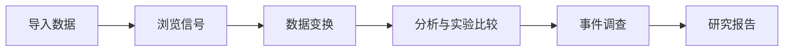

# L5 — Industrial Process Analysis & Investigation Workspace

**工业时序数据分析、异常检测、过程模型实验与事件调查。**

[English](README.en.md) · [快速开始](#快速开始) · [核心功能](#核心功能) · [TEP 案例](#tennessee-eastman-案例) · [架构](docs/architecture.md) · [文档](#示例与文档)

[](https://github.com/dongxuelian2/L5/actions/workflows/check.yml)

L5 将工业数据、处理步骤、检测结果和调查证据组织在一个可持续保存的本地项目中。从自己的 CSV 开始，浏览多源曲线、生成派生数据、比较九种检测算法，再将异常区间、证据与结论汇成事件和离线报告。TripLens 与双水箱模型提供从故障场景到干预实验的另一条完整路径。


*将三源 CSV 对齐为派生 Dataset，在同一时间轴上比较九种算法，再将结果关联到 Incident。图中为本轮实际保存的示例实验。*

## 核心功能

| 模块 | 可以完成的工作 |
|---|---|
| **Data Management** | 创建持久化 Workspace，导入 CSV／TSV，预览样本、时间轴和质量，管理多个 Dataset 与历史结果。 |
| **Signal Explorer** | 编辑信号名称、工程单位、设备和标签；关联多源时钟，以共享窗口和游标浏览原始测量、缺测与采样空档，保存浏览视图。 |
| **Data Transformation** | 转换单位、重采样、处理重复时间和缺失值，计算派生变量；预览实际曲线与逐点来源，生成可直接分析的 Dataset。 |
| **Anomaly Detection** | 运行 Robust Max-Z、PCA-Q／T²、EWMA、Page CUSUM、有限窗口 CUSUM、DPCA-Q／T²、自适应 Max-Z（Experimental）；查看分数、阈值、区间和变量贡献。 |
| **Experiment & Benchmark** | 批量比较算法与参数，独立配置正常拟合、校准和测试数据；保留每次运行快照、逐任务状态、标签评价、研究笔记和结论。 |
| **Incident Investigation** | 将多个 Dataset、分析和异常区间组织为事件；联动时间线、原始曲线、候选解释与支持／反对证据，返回来源继续调查。 |
| **Models & Scenarios** | 从模型目录创建版本化场景、模拟故障、调用调查工具并比较干预；TripLens 提供 18 信号与 12 种故障，Coupled-Tank 提供 7 信号与 4 种故障。 |
| **Reporting & Export** | 从保存结果生成包含真实曲线、来源、参数和结论的独立 HTML；通过浏览器打印保存 A4 PDF，导出分析／事件 JSON 及模拟观测 CSV。 |

## 工作流与界面



**多源信号 → 派生 Dataset**：明确时间关系与单位，保留原始观测和处理来源。

<details>
<summary>查看 Signal Explorer：三源曲线、共同窗口与原始样本游标</summary>


</details>

<details>
<summary>查看 Transformation：多源重采样、单位转换与质量预览</summary>


</details>

**检测结果 → 调查记录**：把算法报警、已知事件与人工观察放入同一条时间线，关联证据和报告。


**模型场景 → 干预对照 → Dataset → Experiment**：保存每次模拟及其配置，再使用同一套数据、分析和调查工具。

<details>
<summary>查看 Coupled-Tank：泵退化场景的液位与进水流量</summary>


</details>

截图来自已完成的真实浏览器验收；[图片来源与对应记录](docs/images/README.md) 可单独查阅。

## Tennessee Eastman 案例

L5 将 [Rieth 等人的官方公开 TEP 仿真数据](https://doi.org/10.7910/DVN/6C3JR1) 接入完整的 Dataset → Experiment → Incident 工作流：**52 个过程变量、九种检测算法、20 种故障、三组正常训练配置**。

扩展研究完成 **585 项**执行，A／B／C 正常训练稳定性研究完成 **1,755 项**执行，共 **2,340 项成功记录**。它们覆盖 **1,755 个独特的训练配置／算法／测试运行组合**；A 配置在两项研究中重复执行并校验。原始 **72 项**独立运行案例另行保留。

| 固定配置 A 的结果 | 30 分钟内检出 / 60 故障事件 | 最终名义检出 / 60 | 正常报警样本 / 4,800 |
|---|---:|---:|---:|
| PCA-Q | 19 | 51 | 2 |
| DPCA-Q | 20 | 54 | 2 |

- **正常训练来源影响误报。** 同样的测试集合和固定参数下，Page CUSUM 的正常报警样本从 A 的 **0** 变为 B 的 **739**、C 的 **1,833**，各组分母均为 4,800。
- **早期检出与持续报警分别评价。** Dashboard 同时展示 30 分钟、1 小时、4 小时及最终命中、检测延迟和报警负担。
- **故障 3 有正常背景对照。** A／run 1 的晚期 DPCA-Q 报警与正常运行出现在同一时段；九组正常／故障配对的报警片段均重合，因此该名义命中没有提供故障 3 特异性证据。


以上为 mode 1、每故障三个测试运行的固定协议结果。[完整扩展研究](docs/tep-benchmark-expanded.md) · [原始 72 项案例](docs/tep-case-study.md) · [数据准备与复现](examples/tep/README.md) · [最终官方验收与产物](https://github.com/dongxuelian2/L5/actions/runs/40197012552)

## 快速开始

需要 **Node.js 20.19+ 或 22.12+、npm、Python 3.12+**。在仓库根目录执行：

```bash
npm ci
python -m venv .venv
node scripts/python.mjs -m pip install -r requirements.txt
npm run build
npm run serve
```

打开 **http://127.0.0.1:8787**，创建 Workspace 并导入 CSV。可从仓库中的 [三份信号示例](examples/data-foundation/README.md) 开始。程序在本机运行，默认使用本地计算引擎；TEP 官方数据按[复现指南](examples/tep/README.md)单独准备。

开发时在两个终端分别运行 `npm run serve` 与 `npm run dev`。Vite 将 `/api` 代理到 8787。Python 脚本优先使用项目 `.venv`，也可通过 `PYTHON` 指定解释器。

项目默认保存在 `data/`：SQLite 保存元数据和调查记录，CSV、NumPy 数组和结果文件保存数值证据。使用同一目录重启即可继续工作；可通过 `L5_DATA_DIR` 或以下命令指定保存位置：

```bash
node scripts/python.mjs server.py --data-dir /path/to/l5-data
```

## 示例与文档

| 从这里开始 | 进一步了解 |
|---|---|
| [操作指南：数据、信号与变换](docs/user-guide.md#数据与信号) | [信号和时间语义验收](docs/signal-workspace-validation.md) · [变换验证](docs/transformation-validation.md) |
| [分析与实验](docs/user-guide.md#分析与实验) | [批量执行、标签和评价规则](docs/experiment-validation.md) |
| [模型与场景](docs/user-guide.md#模型与场景) | [模型接口、方程与参数](docs/model-workspace.md) · [实际模型验收](docs/model-workspace-validation.md) |
| [事件与报告](docs/user-guide.md#事件与报告) | [时间线、报告和重启验收](docs/incident-reporting-validation.md) |
| [TEP 原始案例](docs/tep-case-study.md) · [扩展 Benchmark](docs/tep-benchmark-expanded.md) | [复现指南与结果文件](examples/tep/README.md) · [早期算法研究](benchmarks/README.md) |
| [第一阶段成果总结](docs/stage-one-summary.md) | [架构与存储](docs/architecture.md) · [本轮整合验证](docs/stage-one-validation.md) |
| [TripLens 示例视频](video/README.md) | 在程序中打开 **TripLens examples**，浏览原有调查与教学案例。 |

## 开发与验证

React 19、TypeScript、Vite 构成前端；Python 3.12+、NumPy、pandas 与 SQLite 提供本地分析和存储。现有 CI 在 **Windows 与 Ubuntu** 上执行产品检查，公开研究协议和历史验收记录保存在仓库中。

```bash
npm run check             # Workspace／模拟 Python、React DOM、TypeScript、生产构建
npm run test:research     # 研究回归
npm run verify:artifacts  # 按需重新验证已发布的示例数值产物
```

[第一阶段成果与验证索引](docs/stage-one-summary.md) · [研究整合记录](docs/integration-2026-10-23.md) · [MIT License](LICENSE)
