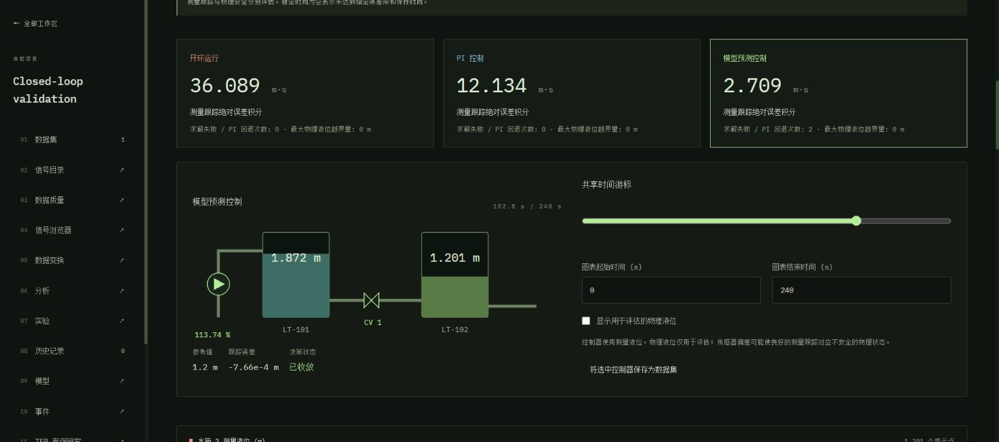

# Closed-loop Control Workspace

**Control / 闭环控制** runs open-loop, PI and receding-horizon MPC on the coupled-tank process. It is a local simulation and evaluation tool; it does not connect to plant equipment.



## Run, compare and investigate

1. Start L5 with `npm run serve`, open a workspace and select **12 Control**. Models also links to this page.
2. Choose a saved coupled-tank scenario, or expand **Plant, fault and measurement settings**. Saved scenarios run their exact version. Custom configuration is retained with the completed comparison.
3. Edit the control interval, piecewise-constant Tank 2 reference, actuator bounds/rates and operational level bounds. Reference points start at zero and increase strictly; blank slew limits disable rate constraints. Horizons count control samples: 25 samples at 2 s predict 50 s.
4. Select one to three controllers and edit their parameters. Connection-valve actuation is enabled separately for PI/MPC. The outlet valve stays a plant parameter. Optional nonoverlapping disturbances multiply inlet/outlet flows; the existing four tank faults remain available through scenario configuration.
5. **Run & save comparison** saves completed results automatically. Select a controller card, move the shared cursor and adjust the common plot window. Commands/references use zero-order-hold plots. Toggle physical levels separately from measurements. Inspect predictions, optimized sequences, residuals and fallback decisions in the decision ledger.
6. Reopen comparisons from the saved list without rerunning them. Editing parameters creates another immutable comparison. Export full-resolution CSV, complete numerical JSON or bilingual offline HTML with embedded SVG figures; print the report to PDF in the browser.
7. **Save selected controller as Dataset** creates a normal model Dataset with seven measurements plus reference/error. Continue to detector **Experiments** or link it to an **Incident**. The Dataset/model session retain the control experiment ID, parameters, solver, metrics and protocol; the complete prediction/decision ledger remains in the control experiment. One-time intervention replay is disabled for these sessions because it would discard their feedback input history. Compute another policy in Control instead.

## Physics, chronology and available information

The existing physical equations are preserved:

\[
A_1\dot h_1=q_{in}-q_{12}-q_{leak}-q_{spill,1},\qquad
A_2\dot h_2=q_{12}-q_{out}-q_{spill,2},
\]

\[
q_{12}=C_v v\,\operatorname{sgn}(h_1-h_2)\sqrt{|h_1-h_2|},\quad
q_{out}=C_o v_o\sqrt{\max(0,h_2)},\quad q_{in}=Q_p p/100.
\]

Faults change the same efficiencies, discharge coefficients, leakage or sensor bias as ordinary tank simulations. Disturbances act on half-open intervals. The shared conservative donor limiter and SSPRK2 integration keep heads nonnegative and use identical transfer flux for both tanks. Substeps split at discontinuities. `massResidual` accounts for inlet, outlet, leakage and both spills.

At a control tick, acquire the current measured levels/flows and previous commands, compute a new command, and then advance the plant. Only that measurement row crosses the feedback callback boundary. Controller constructors receive nominal geometry/discharge constants, operator settings and initial commands. They receive no hidden heads, fault identity/onset/intensity, disturbance schedule, noise seed, future measurements or ground-truth labels.

Both level sensors and three flow meters are assumed available. The illustrative flow meters have no additional noise. MPC estimates present pump gain from measured inlet flow divided by the previous nonzero command. It filters one-step level innovations into a causal, clipped additive derivative disturbance estimate. This is a simple estimator, not general fault isolation or a dropout-capable state observer. Level-sensor bias can cause physically wrong tracking.

All branches share initial conditions, plant/fault/disturbance configuration, reference and seeded noise realization. Their common observation grid combines model samples, control ticks, reference changes and disturbance endpoints. Measurements precede actuation: exported commands describe the new held action, while flow samples describe the just-acquired flow. The decision record explicitly preserves the prior command.

Slew limits mean `|u[k]-u[k-1]| <= rate * controlInterval`. At time zero, the configured initial command supplies `u[-1]`. No extra decision occurs at the terminal time. An off-clock reference change reaches the next decision unless scheduled-reference preview is enabled. Only references may be previewed; future physical faults/disturbances stay hidden.

## PI baseline

With `e = reference - measuredLevel2`, the pump uses nominal equilibrium feedforward plus `kp*e + integral`. Defaults are **180 %/m** and **2 %/(m·s)**, fixed engineering choices based on nominal equilibrium and hydraulic response time. They were not selected using the evaluation cases below. Users can tune them independently; this is a practical baseline, not a claimed optimal PI design.

Conditional integration freezes increments that push farther into magnitude or slew saturation, while permitting increments that unwind it. The applied command is projected onto both limits. Optional valve feedback uses `valveBias + valveKp*e` with its own magnitude/slew projection. Pump-only control is the default for both PI and MPC.

## MPC derivation and solver

Each decision linearizes the nominal hydraulic vector field at the nonnegative measured state and previous command. The affine offset preserves the vector field at that point. Square-root derivatives are regularized below 0.02 m, including nearly equal heads. The physical simulator retains its original square-root law. Repeated affine RK2 substeps of at most 0.25 s discretize the approximation; that affine model is held over the prediction horizon.

For prediction horizon `N` and control horizon `M <= N`, optimize normalized pump/valve commands `u[0:M]`, holding the last action after `M`. Condensing the affine recurrence gives a strictly convex QP:

\[
\min_{U,s\ge0}\;w_y\sum_{k=1}^N(\hat h_{2,k}-r_k)^2
+w_{\Delta}\sum_{k=0}^{M-1}\|u_k-u_{k-1}\|^2
+w_u\sum_{k=0}^{M-1}(p_k^2+0.2v_k^2)
+w_s(s_1^2+s_2^2).
\]

Pump variables here are fractions (`1 = 100%`). Effort penalties apply to independent control-horizon actions. The first increment is relative to the actually applied previous command. Predicted levels satisfy `levelMin[j]-s[j] <= h[j,k] <= levelMax[j]+s[j]`; one nonnegative slack per tank bounds its worst horizon excursion. Magnitude and slew constraints are hard. Disabling valve actuation fixes its optimization variables. Save the complete optimized sequence/prediction, apply only its first action, then measure and solve again.

The QP uses [SciPy SLSQP](https://docs.scipy.org/doc/scipy-1.16.2/reference/optimize.minimize-slsqp.html), with analytic objective/constraint Jacobians and explicit linear constraints. NumPy checks the positive-definite Hessian. Returned multipliers support independent checks of primal feasibility, Lagrangian stationarity, dual sign and complementarity, at default tolerance `1e-5`. A successful optimizer exit is insufficient without those checks. SLSQP line-search status 8 can be accepted only when all KKT checks pass; convexity makes those conditions sufficient for an optimum at the stated tolerance. Raw optimizer status and residuals remain visible.

Iteration limits, residual-check failures and numerical failures reject the candidate. A bounded, slew-limited PI fallback supplies that action, using fixed baseline gains and an integral synchronized to the last applied MPC command. Failed iterates are never applied. Save fallback evidence, timings, model version and installed NumPy/SciPy versions. The solver does not certify infeasibility: `infeasibleSteps` remains zero and does not prove physical objectives achievable.

**Operational level bounds are soft model predictions, not guaranteed physical safety constraints.** Model mismatch, biased sensors, disturbances, initial violations and insufficient actuator authority can cause real excursions. Physical violations and overflow are evaluated independently. This formulation provides no robust uncertainty bounds, terminal stability proof, delay/dropout model or real-time deadline guarantee.

## Metric definitions

| Metric | Definition |
|---|---|
| Measured / physical IAE | Left-rectangle integral of absolute Tank 2 reference error on the saved grid. Physical IAE uses evaluation-only true levels. Reference changes are grid points and contribute no error before their time. |
| Overshoot | Largest positive measured `level2 - currentReference`, including noise and anticipatory deviation before a scheduled increase. |
| Final settling time | Time after the final reference change from which all remaining samples stay in the configured band, with at least the specified dwell remaining. Null means not achieved. |
| Effort / variation | Integral of squared normalized pump command; sum of absolute sampled command changes. Valve variation is separate. |
| Physical violations | Sampled duration outside either tank's operational interval and largest excess. Overflow is integrated by the conservative physical solver. |
| Recovery | Measured settling after an external disturbance/finite fault ends, or from persistent fault onset. Stop at the next reference/disturbance/fault-onset event. Null means no recovery within that window/dwell. |
| Failures / infeasible | Rejected optimization steps with PI fallback; separately, certified infeasible steps (unsupported by this solver). |
| Computation | Mean/max time for processing, prediction, optimization and action selection. Machine dependent; not a real-time feasibility claim. |

## Reproduce and assess the benchmark

```sh
node scripts/python.mjs scripts/benchmark-control.py
# Optionally retain complete experiments in a separate local data directory:
node scripts/python.mjs scripts/benchmark-control.py --data-dir output/control-benchmark
node scripts/python.mjs server.py --data-dir output/control-benchmark
```

The second command prints the Workspace URL for reopening full results. [Numerical evidence](control-benchmark.json) retains full configurations, protocols, controller settings, metrics, status counts and untimed trajectory/decision hashes. Seed is 947; noise is 0.002 m except quiet regulation (0.01 m). Parameters are fixed before this suite, with no gain/weight selection on its cases. Scheduled-step MPC receives reference preview; unannounced-step MPC explicitly does not. Timing and floating-point details vary by machine/BLAS, so hashes are audit fingerprints rather than cross-platform acceptance criteria.

| Case | Open-loop IAE | PI IAE | MPC IAE | Rejected MPC steps |
|---|---:|---:|---:|---:|
| Scheduled 1 → 1.25 m step | 33.8187 | 12.3028 | 3.7539 | 0 |
| Same step, preview disabled | 33.8187 | 12.3028 | 9.8953 | 1 |
| Outlet demand disturbance | 27.7791 | 18.2725 | 9.2901 | 2 |
| Temporary pump degradation | 22.9280 | 10.6424 | 0.4785 | 0 |
| Severe, unreachable pump loss | 78.8758 | 66.7527 | 62.3747 | 1 |
| Temporary valve restriction, both actuate valve | 34.1443 | 33.0103 | 22.8907 | 0 |
| Persistent level sensor bias | 40.9165 | 11.2183 | 6.9925 | 1 |
| Quiet regulation with sensor noise | 1.4878 | 1.5142 | 1.6424 | 1 |
| Initially exceeded level bounds | 50.9055 | 23.9252 | 17.5899 | 0 |

IAE units are m·s. Scheduled-step improvement is about 69.5%, including preview; this is not an equal-information superiority claim. Without preview the improvement is about 19.6%. Unfavorable results remain part of the evidence:

- Scheduled-step overshoot is **0.1079 m** for MPC versus **0.0525 m** for PI under the current-reference definition. Pump variation is **326.44%** versus **105.02%**. Preview begins filling before the step.
- Quiet regulation favors open loop and PI. MPC responds more strongly to noise, increasing measured/physical IAE and actuator movement.
- Under sensor bias, smaller measured IAE conceals MPC's **physical IAE of 34.5997 m·s**, worse than PI's **32.5866** and healthy open loop's **0**. Tracking the biased sensor is not physical success.
- Under restriction, MPC's maximum physical excursion is **0.0351 m**, versus PI's **0.4978 m**. Both violate the operational bound.
- Severe pump loss stays untrackable, and initially excessive levels cannot be repaired instantaneously. These failures remain in the physical metrics.

## API, persistence and validation

`GET/POST /api/workspaces/{workspaceId}/control` lists or executes comparisons. POST accepts `name`, either `config` or `scenarioId`/`scenarioVersion`, and `protocol`. `GET .../control/{id}` reopens complete numerical JSON. `POST .../{id}/dataset` with `{ "controller": "mpc" }` idempotently saves a branch. `GET .../{id}/results.csv` includes explicitly named physical levels/residuals; `GET .../{id}/report.html?lang=zh-CN` generates an offline report.

SQLite stores immutable payloads under the workspace foreign key and branch-to-Dataset references. Existing model sessions, Dataset storage and reporting helpers are reused. Limits of 1,500 decisions/controller, 60 prediction samples, 20 moves and a combined 200,000 decision/horizon product bound local requests. Execution is synchronous; leaving a page does not cancel computation already running on the server. Only completed comparisons enter the saved list.

`tests/test_control.py` covers causal and hidden-future perturbations, matched noise, mass conservation/nonnegative heads, bounds/rates, anti-windup, independent QP optima/hydraulic derivatives, repeated first moves, forced failures, metrics, persistence/restart, Dataset/Experiment/Incident integration and translated reports. React DOM tests cover submitted parameters, reopening/races, synchronized cursors, language switching and Dataset links. `npm run check` runs them, existing regressions and the production build.

## 中文使用说明

在项目侧栏选择 **12 闭环控制**，选择已保存的耦合水箱场景或展开自定义过程参数。配置控制周期、从零时刻开始的参考轨迹、泵和阀门幅值与变化速率约束，再选择开环、PI、MPC 中的一至三种策略。预测和控制时域以控制采样步为单位；「预览计划的设定值」仅开放参考轨迹，不开放未来故障或扰动。

点击「运行并保存比较」后，结果自动保存在本地。控制器卡片切换当前策略；共享游标同步液位示意图、五张趋势图和逐步决策证据。液位边界是软预测约束，实际越界独立统计；传感器偏差场景尤其需要同时检查测量跟踪与物理误差。求解或残差检查失败时使用满足执行器约束的 PI 回退，并保留证据。

可导出 CSV、完整 JSON 和离线中英文报告。将选中控制器保存为普通 Dataset 后，可创建检测实验或关联至事件。重开记录不会重新求解；修改参数会产生新记录。基准同时保留改善、超调和执行器变差代价、噪声场景劣势以及传感器偏差导致的物理误差，不假定 MPC 普遍优于 PI。
