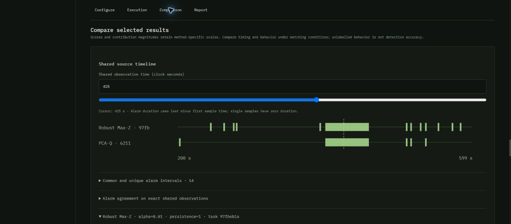
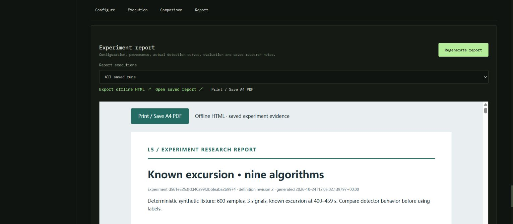
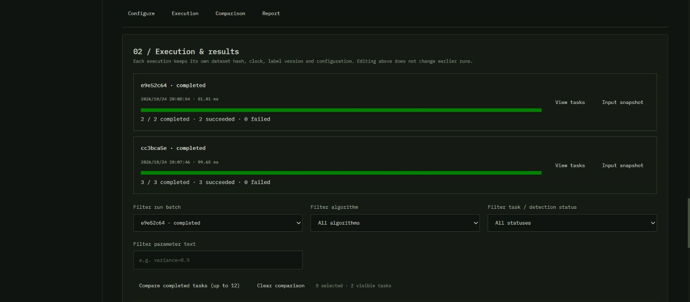

# Unified Analysis & Experiment Workspace 验证

验证日期：2026-10-24，Asia/Shanghai。本分支从已合并 PR #19 的最新 main（`68273a5`）建立，保留现有 Python + SQLite + React 模块化单体和九种检测实现。

## 自动验证

`npm run check` 通过：54 项 Workspace Python、40 项模拟 Python、33 项真实 React DOM 交互测试，以及 TypeScript 和 Vite 生产构建。GitHub 的既有 Check 工作流在 Ubuntu 和 Windows 重复同一门禁。

新增 `tests/test_experiments.py` 覆盖：

- 九算法批量执行，稳定任务／结果身份，真实曲线报告及服务重启后相同运行记录。
- 参数笛卡尔组合、8 候选／64 任务限制、配置修订、复制、重新执行与历史不覆盖。
- 不规则时间导致部分任务失败时保留成功结果；失败／中断任务在新运行中使用原快照重试。
- 标签版本、未标注时间、abstain、正常／异常闭区间、零分母、单点报警与采样长空档规则。
- 样本级 TP/FP/TN/FN 与事件级检出／漏检／无观测、正常区间报警事件及故障起始延迟。
- 派生数据 measured/processed 覆盖差异、来源与旧运行保留、区间级 Incident 及报告来源。
- TripLens 保存的故障真值、派生时间零点映射，以及修改数据参考时钟后历史比较仍使用旧快照。
- 持有 Workspace 读取事务时，后台批次仍可提交全部结果；读者保留自己的 SQLite 快照。

新增 DOM 测试操作实际组件：选择九种算法、设置参数候选和规模上限、任务预览、保存笔记／结论与运行引用、筛选失败任务、关联真实任务 ID、导入标签、拒绝迟到的实验加载及跨实验的过期保存响应、同步检测图和原始测量游标、拒绝过期报告。旧的 26 项交互测试继续通过。

## 实际 Chromium 流程

使用本地 Python 服务与生产构建，验收目录为独立 `.integration-cache/experiment-browser`，未使用正式用户数据目录。Chrome 自动翻译会改变动态数值文字，因此新实验工作站声明 `translate="no"`，保留算法、信号和数值标识。

本机扩展未启用本地文件 URL 访问，文件选择器的 `setFiles` 被扩展拒绝。CSV 夹具通过同一服务的 Dataset 导入 API 写入，之后的配置、运行、标签编辑、比较、Incident 与报告导出均由真实浏览器完成。夹具为 `tests/test_experiments.py` 的确定性合成数据：600 行、3 个信号、400–459 秒的已知注入偏移；不作为真实工厂检测效果的证据。

### A：九算法、标签与报告

Workspace `8318352a43c941209ce0220165e6b5b3`，原始 Dataset `732ed0540c4a4b90b2e45774a96b403b`，实验 `d561e5253fdd40a99f2bbfeaba2b9974`。

在浏览器选择全部三个信号，基线 0–199 秒，分析 200–599 秒，选择九种方法，预览九个实际任务后执行。运行 `5e9951cb…` 九项全部成功。保存的表格包含首次报警、报警片段／持续时间、有效／abstain 样本、覆盖与耗时；无标签状态明确显示 behavior only。

随后在标签 JSON 编辑器录入正常 200–399、异常 400–459、正常 460–599 秒，声明原生秒数及夹具构造来源，保存独立标签版本。在笔记中记录数据为合成夹具，结论引用原运行。运行 `0ab0ea84…` 再次九项成功，旧运行仍保留。选中 Max-Z 和 PCA-Q，在 425 秒同步读取原始样本 `a=9.469…`、`b=-0.542…`、`c=-2.661…`，各分数图仍使用独立纵轴。

将两个算法实际的 400–459 秒报警区间加入新事件 `a4018b66ced5455985b69561955df981`。事件中保留两个 interval 来源、运行／任务／AnalysisResult ID，并可返回来源实验；没有偷偷加入整份分析来扩大区间范围。

生成并实际下载独立 HTML。核验文件包含 26 个内嵌 SVG、保存的结论、样本和事件评价、实际参数／结果 ID，且没有外部 `src`／`href` 资源依赖。报告正文与预览来自保存记录。

### B：复制与参数研究

复制上述实验得到 `8de37fde267b447a81d64484a76ded85`，改为仅 PCA-Q。浏览器设置 variance `0.6, 0.8, 0.95`，预览三个参数配置并执行，运行 `cc3bca5e…` 三项成功。再改为 `0.7, 0.9`，运行 `e9e52c64…` 两项成功。两个批次及其三个／两个任务同时保留。

### C：派生 Dataset

通过已有 Transformation API 将原始三个信号生成 0.5 秒共同网格，并增加 `delta = a - b`。定义 `cedab44254654d4d8ad90ebffda9586e` 产生 Dataset `f1f43641958d4791b9e01eae729ec8b6`，共 1,199 行、4 个信号，保留原始／插值掩码和来源哈希。

浏览器从该 Dataset 创建实验 `2db3782e71d2459d84829062e0b32ac0`，显式选择 processed 观测策略，配置同样基线／分析窗口，运行 `f3c06a27…` 九项全部成功。两个算法的实际 399.5–459.5 秒区间可选择为 Incident 来源。实验报告读取派生数据的固定来源、表达式、网格与处理参数。

自动测试另行验证 measured 策略下插值不计覆盖，时序算法拒绝不连续的基线；明确切换 processed 后同一组任务完成，原 measured 运行保留。

### D：TripLens 真值与部分失败恢复

浏览器创建 cooling_valve 会话 `6c50747cce724e1e867102000ea204de`：故障开始 43.7 秒、时长 150 秒、步长 0.2 秒、种子 77，保存为 751 行普通 Dataset。实验 `90c6496777164e63b49f0c8602f45903` 通过 **Use saved TripLens truth** 从保存配置建立明确的 simulation truth，使用基线 0–19.8 秒、分析 20–150 秒。

真实验收发现批量提交和嵌套 Workspace 查询在 SQLite 原 journal 模式下产生一次 `database is locked`：首批八项成功、一项失败。保留该批次及成功结果，增加 WAL 和持有读取事务的回归测试后重启。浏览器 **Retry unfinished tasks** 生成 `3b5dfb4a…`，仅重试的 PCA-Q 成功；随后完整运行 `89da9e28…` 九项全部成功。

Max-Z 的保存评价为 TP=532、FP=0、TN=119、FN=0；651 个有效评价样本、一个检出的已知异常事件，首次事件内报警为 43.8 秒，对保存的 43.7 秒起点延迟 0.1 秒。其他方法有各自的误报与统计。这些值仅描述该次模拟条件，不能解释为真实工业数据上的准确率保证。

### E：重启与兼容性

实际停止并重启同一隔离服务，重新打开实验。重启前保存的九个 AnalysisResult 文件 SHA-256 全部一致，后续标签、配置和再次执行没有改写旧结果。实际事件仍能返回原实验。自动 HTTP 测试另外重启服务，比较整个运行对象完全相等，并重新读取标签与复制定义；中断恢复测试保留已完成任务，只将未完成任务标记 interrupted。

## 规则与边界

- 本地单工作线程、最多四个活动批次。重启不会自动重放未完成任务，用户可选择在新运行中重试。快照保存输入、参数、源码哈希与版本信息，未打包独立可执行环境。
- 只在明确标注且非 abstain 的样本上计算混淆矩阵。Precision/F1 是标注范围内的统计；只有异常标签时不能据此推断未标注时间的误报。零分母返回未定义。
- 事件检出以事件内的实际报警样本为准；完全无有效观测的真值事件不塞进漏检分母。正常区间报警事件和样本 FP 单独统计。
- 不同原始分数／贡献度不作为跨算法排名。共同／独有区间排除不共同观测的范围；样本一致性只配对精确共同时间戳，重复时间戳会标明不可配对。
- 详细浏览器比较最多选择 12 项；报告每次运行的详细共同区间比较最多 12 项，测量图最多展示 8 个输入。全部任务摘要、身份、配置和独立检测曲线仍保留。
- 已核验 HTML 预览和实际下载。PDF 使用已有浏览器 A4 打印流程；本轮没有把打印对话框保存为 PDF 文件，不宣称验证了具体打印机或 PDF 输出二进制。
- 无新增检测算法、行业模型、分布式调度或通用工作流引擎。既有 Incident 调查、派生数据、模拟工具和历史结果继续使用原路径。
