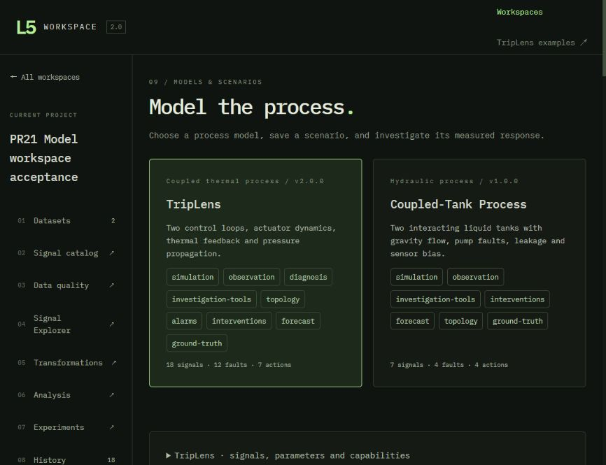
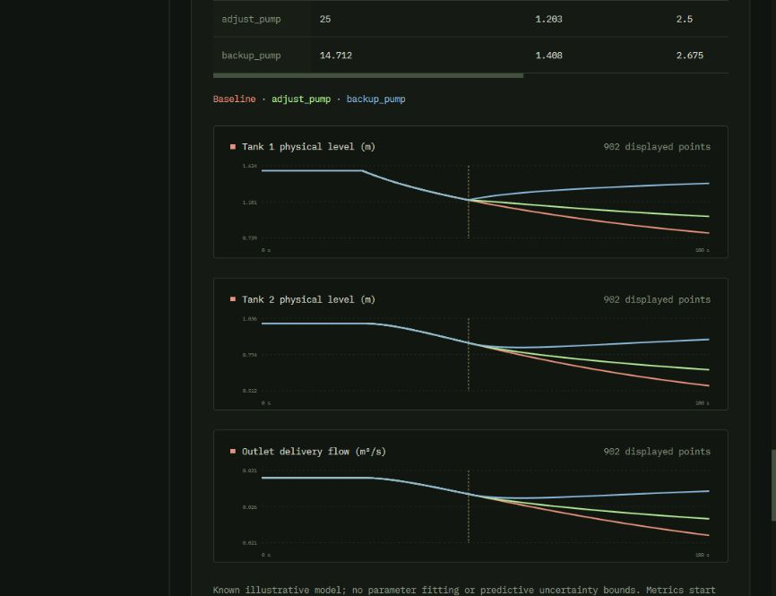
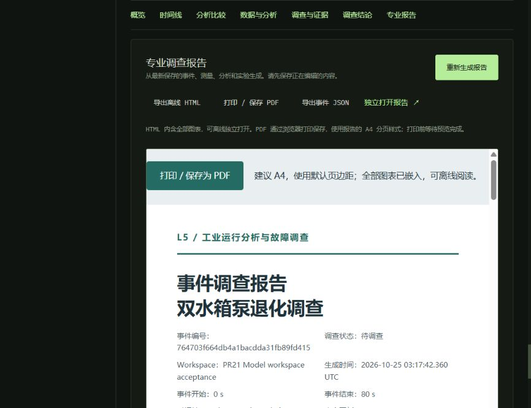

# Model & Scenario Workspace 验收

基线为合并 PR #20 后的 main `bd179182f9dbc0c845b6525650fb08ab6156096a`。分支为 `codex/model-scenario-workspace`。本轮没有合并其他 PR。以下结果来自 2026-10-25 的实际本机运行。

## 自动检查

`npm run check` 通过：63 项 Workspace Python、40 项模拟 Python、40 项 React DOM 交互测试，随后 TypeScript 和 Vite 生产构建成功。Windows 本机测试将临时数据库放在工作区内，并按 CI 配置设置 `NO_PROXY=127.0.0.1,localhost,::1`；未设置时，旧模拟 API 测试曾被系统代理返回 502，设置后通过。

新增 `tests/test_models.py` 验证：

- 健康平衡、干箱、反向流、溢流、泄漏及小面积工况的质量守恒和非负物理液位。
- 积分步长 0.025/0.05/0.1 s 以及采样 0.2/0.4 s 的数值一致性；固定种子重复测量相同，改变种子只改变测量噪声。
- 泵退化、连接阀受限和泄漏的响应方向；传感器偏置不改变物理状态。
- 83.17 s 这种非采样时刻的干预前缀一致性，以及实际控制参数改变后的轨迹和指标变化。
- HTTP 模型目录、场景保存／复制／版本冲突、重复运行、Workspace 边界、服务重启和旧版本配置保留。
- 两个模型分别保存 Dataset，使用各自真值运行全部九种检测算法，关联工具、干预、AnalysisResult 和 Incident，再生成两类报告并重启恢复。
- 有限故障结束之后不生成健康标签，派生 Dataset 保留模型快照与正确的时钟映射；旧 TripLens 文件读取不改写。
- 已保存的完整模型快照可以在实现不再注册时读取；新的计算请求明确拒绝，不映射到另一个模型。
- 仅声明模拟与观察的测试适配器复用真实水箱方程，不实现工具、干预或真值方法，仍能运行和保存；不支持的 API 明确返回 400。

新增 DOM 交互检查覆盖后端目录生成表单、保存新场景版本后再运行、通用干预参数恢复、不同观察窗口的历史结果隔离、Incident 的模型指标展示、过期会话／场景响应，以及跨模型研究表的各自来源与评价分母。

## 数值结果

默认无故障、无噪声的 180 s 运行保持 `h1=1.5625 m`、`h2=1 m`，质量残差为 0。健康、泄漏、反向流、干箱和溢流测试的最大绝对体积残差小于 `1e-9 m³`，所有物理液位非负。泄漏运行中，0.025 与 0.05 s 的液位差小于 `2e-6 m`；0.1 s 积分配合 0.4 s 采样与默认结果的差小于 `1e-5 m`。这些阈值验证数值实现，不代表实际装置精度。

浏览器运行的双水箱场景使用泵退化、强度 0.6、故障起点 40.37 s、种子 1、时长 180 s、采样 0.2 s、积分 0.05 s。观察至 80 s，动作从 83.17 s 开始。保存的实际结果为：

| 方案 | Tank 2 液位绝对偏差积分 m·s | 预测期峰值液位 m | 供水量 m³ | 溢流 m³ |
|---|---:|---:|---:|---:|
| 不干预 | 30.581 | 1.203 | 2.398 | 0 |
| 泵命令 125% | 25.000 | 1.203 | 2.500 | 0 |
| 切换备用泵，命令 100% | 14.712 | 1.408 | 2.675 | 0 |

TripLens 的浏览器已知模型试验使用冷却阀故障，观察至 93 s，在 96.4 s 干预，预测至 240 s。基准物理压力峰值约 3214.5 kPa，旁路方案约 3025.6 kPa，减料方案约 3112.6 kPa；旁路分支在本次时域内未跨过 3050 kPa，基准及减料分支仍跨限。原有产量、质量和能耗指标继续显示。

## 真实浏览器流程

通过浏览器创建独立验收 Workspace。初始 Chrome 页面的自动翻译改变了部分动态文字，后续使用内置 Chromium 核对原始界面，没有修改浏览器设置。

1. 从实际 Model Catalog 选择双水箱；保存并运行健康场景 v1，编辑为泵退化 v2，再运行。旧健康会话仍指向 v1。
2. 查看带物理单位的实际测量，叠加健康／故障运行；保存流量平衡调查及调泵／备用泵干预对比。
3. 保存双水箱 Dataset，读取对应故障真值，执行九种检测算法；9/9 成功，保存研究记录和结论。
4. 实际导出双水箱 Experiment HTML，文件约 188 KB，包含 14 个内嵌 SVG、模型／场景来源、真值和保存的研究记录，没有外部资源引用。
5. 实际重启 HTTP 服务，恢复已有会话、干预时刻 83.17 s、控制强度和结果。重启前的 13 个 JSON 文件保持原哈希。
6. 从双水箱干预结果创建 Incident，加入 PCA-Q 分析和已保存工具，保存结论。专业报告显示双水箱模型、场景 v2、测量单位及真实物理液位／供水指标，不套用 TripLens 压力指标。
7. 从统一目录运行 TripLens，调用原传感器一致性工具并比较旁路／减料干预。保存第二份 Dataset，使用该模型自己的真值执行九算法批次，9/9 成功，生成并预览第二份 Experiment 报告。
8. 从 TripLens 干预创建第二个 Incident，保存候选解释、调查笔记和结论，原有物理压力报告正常预览。再次实际重启服务，2 Dataset、18 AnalysisResult、2 Experiment、18 任务、2 Incident 和 2 调查记录保留，30 个历史文件哈希与全部数据库表记录数不变。
9. 在 Models 的研究索引中查看两个模型的 18 项实际结果，来源模型、场景、标签版本和评价分母各自保留。

另从实际 HTTP 下载接口导出 TripLens Experiment 及两个 Incident 的独立 HTML，检查各自模型身份和内嵌 SVG；文件保存在本机 `output/model-acceptance/`。浏览器实际下载与 HTTP 导出的大小、SVG 数量和 SHA-256 记录在 [机器可读验收记录](verification/model-workspace-2026-10-25.json)。

浏览器发现并修复了 Dataset 页两个链接的点击区域重叠：创建多算法实验入口可能误入模拟会话。改为有间距的独立操作区域后，实际点击可以进入正确的 Experiment 配置，来源名称分别显示 TripLens 与 Coupled-Tank Process。

在默认约 870 px 的验收视口检查并修复模型卡片的最小内容宽度与换行。目录文档宽度不再超过视口；研究及指标表的横向滚动限定在各自表格容器。

[双水箱干预指标表](images/model-tank-interventions.png)

## 已有数据副本迁移

没有在原验收数据上执行迁移写入。使用 SQLite backup 取得一致副本，复制关联 CSV、NumPy 和结果文件，再用新版本打开。

| 原有副本 | 保留记录 | 检查结果 |
|---|---|---|
| PR #20 实验验收数据 | 3 Dataset、50 AnalysisResult、1 变换、4 Experiment、8 批次、51 任务、2 标签版本、2 Incident、2 研究记录修订 | 全部旧表记录数不变；57 个历史文件哈希不变；2 个事件报告、4 个实验报告重新生成成功 |
| 早期 Incident 验收数据 | 2 Dataset、2 AnalysisResult、2 Incident、5 来源关联、5 调查记录 | 全部旧表记录数和 9 个历史文件哈希不变；已有事件报告正常生成 |

迁移只新增场景表。缺少正式模型版本的 TripLens 会话读取时补充兼容视图，不重写原会话。已有报告 HTML 文件不会被迁移修改；重新生成会使用保存的来源和结果。

## 边界

双水箱参数和故障强度是演示配置，未针对实际工厂标定。它支持已知模型预测，不支持观测拟合、诊断分类、自动恢复窗口搜索或预测不确定度。备用泵切换没有额外费用模型。物理守恒与数值一致性不等于外部工艺验证。

场景计算仍是本机同步请求；没有增加分布式任务系统。模型研究索引最多显示最近 100 批次中的 200 项任务，完整历史留在各 Experiment。报告继续复用独立 HTML 与浏览器 A4 打印，本轮不保存 PDF 二进制。无过程模型的真实 CSV 不提供物理干预预测。
