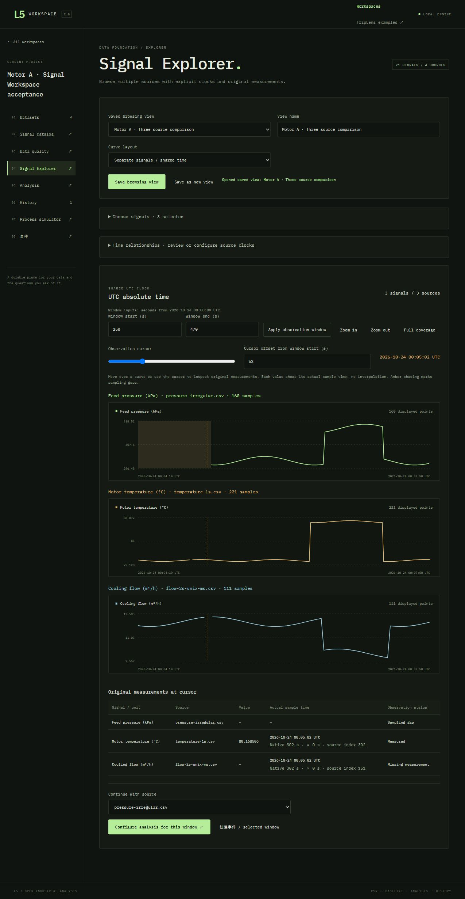
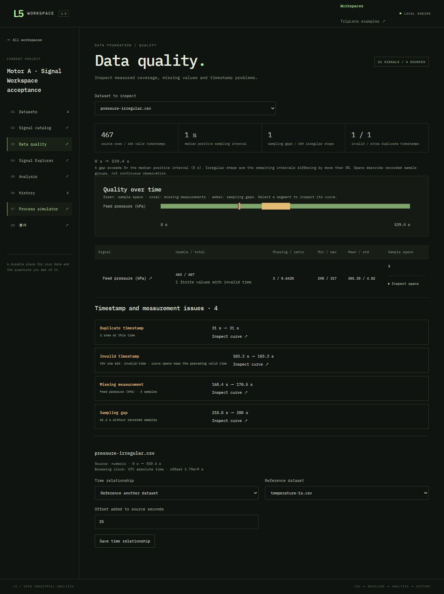

# Signal & Time-Series Workspace validation

Validated on 2026-10-24 using the Windows checkout and the actual Chromium in-app browser. The feature branch starts at merged PR #17 (`e836441`). No other pull request was merged during this work.

## Three-source browser workflow

Created a dedicated local acceptance workspace and imported all three [example CSVs](../examples/data-foundation/README.md) through the real file chooser:

| Source | Saved time interpretation | Actual quality results |
|---|---|---|
| Temperature | ISO timestamps with +08:00, normalized to UTC | 600 rows, 599 usable values, 1 missing value, 1 s typical interval |
| Flow | Explicit Unix epoch milliseconds | 261 rows, 259 usable values, 2 missing values, 2 s interval, source ends at 520 s |
| Pressure | Explicit relative numeric seconds | 467 source rows, 466 valid timestamps, 463 usable values, 3 missing measurements, 1 invalid time, 1 extra duplicate, 309 irregular intervals, 61.2 s sampling gap |

Edited each signal's display name, physical unit, category, device, logical measurement key and tags in the catalog. All three belong to Motor A and retain their raw column names. The pressure source initially has an independent clock. Saved an explicit reference to temperature with a +25 s offset; the three sources then share UTC.

Selected the three signals in the catalog, opened Signal Explorer and applied the 250–470 s UTC observation window. Pressure, temperature and flow have separate value scales and the same horizontal bounds. At source-reference second 302, the cursor shows:

- Temperature: original value **80.168506 °C**, actual source index 302 and zero time difference.
- Flow: **missing measurement**, actual source index 151 at 302 s.
- Pressure: **sampling gap**, with no fabricated measurement.

Expanded to full coverage and selected 550 s. Flow reports **outside source coverage**, while other sources display their own actual sample times. Saved the named three-source view with its 250–470 s window and 302 s cursor. Closing and restarting the Python server, then reloading the browser restored all three selections, names, units, time relationship, window and cursor. UTC sliders use offsets within the window, and exact numeric cursor input was exercised.

The quality page shows the pressure issues at their recorded times and CSV row 104 for the invalid timestamp. Clicking its 218.8–280 s gap opens the corresponding original curve. The saved +25 s reference remains visible after restart.

## Monitoring and incidents

From Explorer, selected the temperature source and configured Max-Z using its raw `temp_C` key. The browser carried the selected 250–470 s window into analysis. A healthy 0–119 s baseline produced 84 fit and 36 calibration observations; the target had 221 samples and one abstention. Max-Z detected the synthetic temperature rise at **380–434 s**, including all 55 samples.

Created an Incident from that detected interval, saved a conclusion and generated an offline HTML report. Incident source curves, contributions and report figures display **Motor temperature (°C)** and UTC times. The standalone HTML downloaded successfully. Existing report preview, comparison and timeline controls remain available; automated tests also regenerate reports and exercise their offline markup.

Separately created an Incident directly from the aligned pressure window. It saves native pressure seconds **225–445** and the pressure source reference; its event heading and timeline correctly display **00:04:10–00:07:50 UTC**. This checks that the new workspace uses the existing Incident clock representation.

## TripLens

Created a new pump-degradation session with seed 20261024, 240 s duration and 0.2 s integration step. Saved the dataset and model, then inspected its **18 signals** in the common catalog. Units and simulation provenance are present. Opened the temperature curve in Signal Explorer on its independent simulation clock, then returned to the original process investigation.

Ran a real temperature-window tool through 93 s and saved a comparison of bypass and backup-pump interventions with action time 96 s and prediction end 200 s. After the server restart, both the tool and intervention records remained in Saved experiments. Reopening context restored **96 s** and **200 s**, the selected pump hypothesis and both calculated branches.

## Existing database migration

Copied the prior PR #17 browser acceptance directory into an isolated migration directory, then opened it with the updated store. The source database was kept unchanged.

| Preserved existing records | Count |
|---|---:|
| Workspaces | 2 |
| Datasets | 5 |
| Analyses | 3 |
| Incidents | 3 |
| Source links | 7 |
| Notes / evidence / hypotheses | 5 |
| Incident history records | 10 |

All old datasets, analyses, incident views, model sessions and saved experiments loaded. All three old professional reports regenerated. The migration backfilled **60 stable signal IDs** and quality metadata. SHA-256 checks matched all **19 CSV, NPZ and JSON files** before and after migration. Existing database records matched except for the intended added dataset quality metadata. A separate automated legacy-schema test verifies idempotence and stable IDs across repeated restarts.

## Automated checks

`npm run check` covers:

- 24 Workspace Python tests, including real HTTP import, semantics, UTC/relative references, cycles, ownership, quality, raw cursor reads, analysis, incidents, reports, restart and migration.
- 40 existing TripLens Python tests.
- 23 React DOM interaction tests, including catalog filters/selection, stable-ID metadata edits, saved-view restoration, compatible overlays, raw cursor values, quality navigation, explicit references and stale-response handling.
- TypeScript checking and Vite production build.

On this machine, HTTP tests use `NO_PROXY=127.0.0.1,localhost`, matching the repository CI configuration. Windows tests use a workspace-local temporary directory. GitHub CI runs the same check on Ubuntu and Windows.

## Current boundaries

Time references add offsets without rewriting or merging source arrays. Unit conversion, resampling, interpolation, fusion and derived variables remain for the next data-transformation phase. The gap policy is five times the median positive interval, so very sparse or short sources need user interpretation. Sample spans are recorded groups, not proof of uninterrupted observation. Invalid-time measurements stay in the original CSV and finite-value statistics but are excluded from timed plots and analysis. Duplicate times remain stored; the cursor explicitly shows the first nearest row. PDF export continues to use browser printing; this change validates the HTML export and existing automated report regressions.
