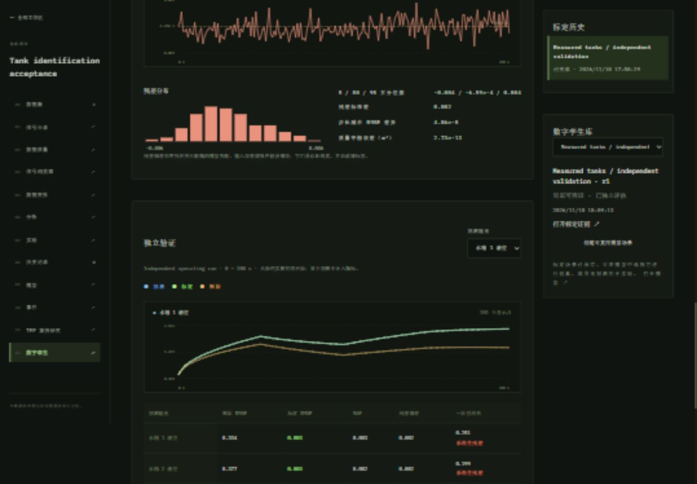

# System identification and calibrated digital twins

Open **Digital twins** in a workspace (or follow the link from Models or a saved
Experiment). This is local, offline output-error identification of the existing
coupled-tank physics. It does not use the control workspace or an online estimator.



## Workflow

1. Import a CSV or save a coupled-tank simulation as a Dataset. Select one
   continuous calibration run and an interval in **dataset seconds**.
2. Map level measurements (`m`), optional inlet / signed transfer / outlet flow
   measurements (`m³/s`), pump commands (`%`) and connection-valve commands
   (`fraction`). Unmapped commands use the explicit fixed model settings. Convert
   incompatible units with Transformations first. Confirm units for an unlabelled
   CSV; changing a signal's display name does not convert its measurements.
3. Select coefficients and optionally initial levels. Set physical bounds and
   starting guesses. Areas, outlet-valve opening and overflow height are fixed
   geometry. For noisy initial observations, estimating `initial1` and `initial2`
   is preferable to treating their first measurements as exact states.
4. Set output noise standard deviations from sensor knowledge. Run identification
   and inspect convergence, parameter rank, weak combinations and residuals.
5. Select a separate validation Dataset or a disjoint interval of the same Dataset.
   Validation includes every fitted output and both initial measured levels;
   additional validation outputs can also be evaluated.
   Its first observation initializes a fresh trajectory and is excluded from
   validation metrics. All subsequent output observations are used **only for
   evaluation**. Coefficients are frozen before validation.
6. Compare the calibrated trajectory with the original nominal model under the
   same commands and state-initialization policy. Inspect RMSE, MAE, signed
   residuals, histograms, quantiles, bias and sample-lag-1 autocorrelation.
7. Save a new twin or append a revision to an existing twin. Each revision retains
   its exact identification run, source fingerprints, intervals, model parameters,
   uncertainty and warnings. Nonconverged results cannot be saved as twins.
8. **Create reusable model scenario** exports that revision to the existing Models
   workspace. Run it, save observations as a Dataset and use existing detector
   experiments / investigations. The simulator uses constant scenario commands;
   the recorded calibration command sequence is not a controller or scenario
   schedule. Saved results remain available after restart.

No independent validation is claimed when none was selected. “Independently
evaluated” means a held-out prediction was scored, not that it passed an automatic
acceptance criterion. An optimizer may converge on uninformative data; a saved
twin retains the non-identifiability warning and is not a unique physical model.

## Equations and numerical method

The fitted healthy tank model uses the same square-root flow laws as
[`l5/models/tanks.py`](../l5/models/tanks.py):

```text
qin = pumpRate * pumpEfficiency * pumpCommand / 100
q12 = connection * valve * sign(h1 - h2) * sqrt(abs(h1 - h2))
qout = outlet * outletValve * sqrt(max(h2, 0))
A1 dh1/dt = qin - q12 - spill1
A2 dh2/dt = q12 - qout - spill2
spilli = 0.1 * max(hi - tankHeight, 0)^1.5
```

The existing conservative donor-limited Euler stage is shared by both ordinary
simulation and the twin's SSPRK2 integration. One limited transfer flux is removed
from its donor and added to its receiver. States remain nonnegative and the volume
balance is conserved to rounding error, including reverse transfer and overflow.
Commands are right-continuous, held on `[t_i, t_{i+1})`; irregular timestamps are
integrated exactly to the observation endpoints without interpolating outputs.

[`l5/identification.py`](../l5/identification.py) minimizes
`0.5 sum(((prediction - observation) / sigma_output)^2)` using SciPy's bounded
[trust-region reflective nonlinear least squares](https://docs.scipy.org/doc/scipy-1.16.2/reference/generated/scipy.optimize.least_squares.html), with three-point derivatives and
fixed engineering parameter scales. This is Gaussian maximum likelihood **only
under** independent output noise with the supplied standard deviations, exact
inputs and the stated model. Missing output observations are omitted. An initial
level observation used for exact state anchoring is not counted again in the
likelihood. The fixed nominal coefficients are the comparison baseline; initial
optimizer guesses are recorded separately.

Calibration never reads a simulation session, parameter truth, fault schedule or
seed. Dataset model IDs are retained only as source links. The example generator
uses simulator truth to produce measurements; it passes only timestamped observed
signals into identification. Geometry and unselected coefficients must be supplied
by the user; they are never recovered silently from Dataset metadata.

For bounded local computation, use 6–2,000 increasing timestamps, at most 7,200 s,
and at most 60,000 integration substeps at the diagnostic half step. Duplicate
timestamps, acquisition gaps greater than five median intervals, incomplete inputs,
and finite interpolated / processed samples are rejected. Explicitly measured
samples of a derived Dataset can be used. Overlapping same-source intervals,
identical reimports and shared transformation ancestry are rejected as independent
validation sources. Renaming, cropping or independently re-exporting an unlinked
file cannot prove independence: the user remains responsible for the experimental
split and for not selecting a model after repeatedly inspecting its holdout.

## Identifiability and uncertainty

The noise-weighted output sensitivity matrix is evaluated at the fitted point.
Columns are multiplied by fixed engineering scales (not user bound widths).
SVD rank uses `max(1e-7, largest singular value * 1e-6)`. Singular directions below
one in these noise / parameter units are flagged as practically weak, as are
full-rank matrices with condition number above `1e5`. These are disclosed numerical
heuristics, not a proof of structural or global identifiability. The UI shows
singular values, column norms, weak right-singular combinations, parameter
correlations (when invertible), or sensitivity-column cosines when singular.

Two deliberate failure examples:

- `pumpRate` and `pumpEfficiency` appear only through their product. Changing the
  input sequence cannot separate them in this model, even with measured inlet
  flow. Fix one factor. The simulator export folds efficiency into pump rate.
- At exact equilibrium with only levels, scaling all three discharge / pump
  coefficients preserves the same levels. A converged representative solution
  does not identify the dynamic time scale; validation after a command change can
  fail badly. Flow measurements or transient excitation can add information.

When the fit is converged, locally informative, interior to its bounds, consistent
with the specified noise and numerically resolved, covariance is approximated by
`(JᵀJ)^-1` in physical units using the SVD. Supplied absolute sensor variances are
used; they are not estimated from holdout residuals. Parameter standard errors and
the `±1.96σ` delta-method trajectory envelope are conditional **local linearized
approximations**, not finite-sample or global confidence guarantees.

Covariance / envelopes are withheld for rank loss, weak excitation, boundary
solutions, nonconvergence, material step-halving differences, unstable finite-difference sensitivities or residual warnings.
The envelope excludes measurement noise, actuator / geometry errors, unestimated
initial-state uncertainty, model mismatch and numerical error. Estimated calibration
initial-state covariance is included; fresh measured validation initialization is
conditioned on and its uncertainty is excluded. There is no clipping an envelope
into a positivity or coverage guarantee.

Residual bias greater than `3 sigma / sqrt(n)`, lag-1 correlation greater than
`3 / sqrt(n)` when residual variation exceeds 10% of sensor noise, or reduced χ²
above two prompts inspection. These are exploratory mismatch diagnostics, not
formal hypothesis tests on fitted residuals or fault classifications. The UI
separates noise, parameter uncertainty, mismatch and numerical approximation.
Step-halving RMSE differences are an empirical resolution check, not an error bound.
Sensitivity derivatives are also checked at half the perturbation size; a relative
scaled-matrix change above 2% suppresses local covariance claims.

Validation also includes 5 / 20 / 60 s rolling predictions at up to 12 deterministic
origins each. Every origin resets to its contemporaneous measured levels and uses
only subsequent commands, with coefficients frozen. Endpoints are the first sample
at or after each horizon; actual horizons are recorded. Overlapping origins are
not independent samples for confidence calculations. The full free-run validation
trajectory is the primary comparison.

## Reproducible evaluation

```bash
node scripts/python.mjs -m benchmarks.calibration_benchmark --datasets output/calibration-examples
node scripts/python.mjs -m unittest discover -s tests -p test_identification.py -v
npm run test:ui
npm run build
```

The first command writes ordinary importable CSVs plus
`output/calibration-benchmark.json`. Fixed protocol: true pump / connection / outlet
coefficients `0.036 / 0.047 / 0.026`; four distinct pump / valve conditions over
200 s; generator step 0.025 s; fitting step 0.05 s; a different initial state and
command sequence in validation; 2 mm Gaussian level noise with calibration seeds
19 / 32 / 71 and a separate validation seed 201. The bounds, noise and starting
guesses are fixed before evaluating holdout data. There is no tuning loop on
validation scores. A separate start-guess run checks local convergence stability.

The compact [reference results](../benchmarks/calibration_reference.json) include
all successful, ambiguous, mismatched and failed cases. On the reference run:

| Case | Rank | Held-out tank 2 RMSE | Interpretation |
|---|---:|---:|---|
| Clean, excited | 3/3 | 0.0000022 m | Coefficient recovery relative errors below 0.00005% |
| Noise seeds 19 / 32 / 71 | 3/3 | 0.00283 / 0.00207 / 0.00201 m | Original nominal RMSE approximately 0.377 m |
| Equilibrium, level-only | 2/3 | 0.378 m | Dynamic coefficient scale not identifiable |
| Capacity and efficiency together | 3/4 | 0.0000022 m | Accurate predictions do not imply unique parameters |
| Unmodeled leak | 3/3 | 0.0200 m | Residual mismatch; covariance withheld |
| One optimizer evaluation | 3/3 | 0.377 m | Nonconverged; cannot save a completed twin |

Across the three noise seeds, coefficient recovery sample standard deviations are
approximately 0.36% / 0.48% / 0.59% of truth. These are small deterministic simulator
benchmarks, not real-plant accuracy or coverage claims. The mismatch case is not
reported as successful physical parameter recovery despite numerical full rank.

## Local API and extension boundary

All routes are workspace scoped:

- `GET /api/workspaces/:id/calibrations/catalog` — physical parameter limits.
- `GET /api/workspaces/:id/calibrations` — latest 200 requests and progress.
- `POST /api/workspaces/:id/calibrations` — immutable request; returns `202`.
- `GET /api/workspaces/:id/calibrations/:run` — poll stages / read saved evidence.
- `GET|POST /api/workspaces/:id/twins` — list / save from a converged `runId`.
- `PATCH /api/workspaces/:id/twins/:twin` — append with `expectedRevision`.
- `GET /api/workspaces/:id/twins/:twin/revisions` — immutable revision history.
- `POST /api/workspaces/:id/twins/:twin/scenario` — export a specified `revision`.

A request has `name`, optional `experimentId`, and `config` with `calibration`,
optional `validation`, `parameters`, optional `nominal`, `noise`, `integrationStep`
and `maxEvaluations`. Each observation reference has `datasetId`, `range`,
`mapping` and `unitsConfirmed: true`. Each selected parameter has `initial`,
`lower`, `upper`. Saved config snapshots can be submitted again; their source
fingerprints are revalidated. One identification runs locally at a time, progress
is persisted, and interrupted jobs are explicitly marked after a service restart.

`predict(config, Observations, step)` is the pure timestamped-input prediction
boundary for future FDI, intervention or predictive-control consumers. Callers
must supply validated physical parameters, inputs and explicit initial states;
it does not assimilate observations or read a simulator session. The twin revision
format includes the identification engine version, physical units, sources and
uncertainty qualifications. Existing model / detector interfaces remain separate.
