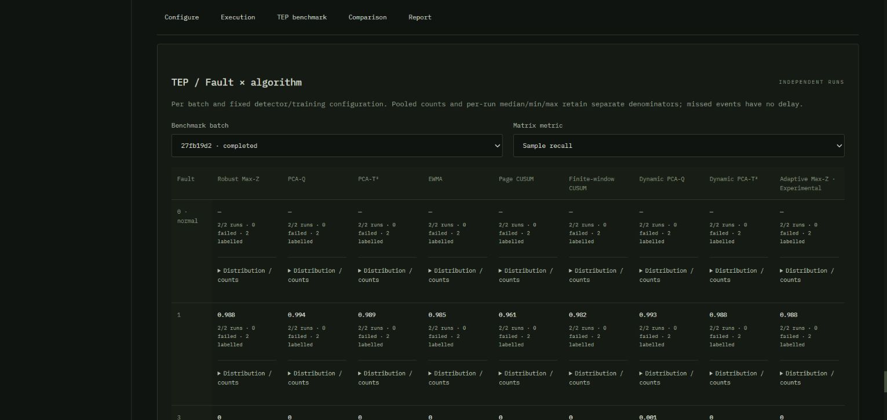
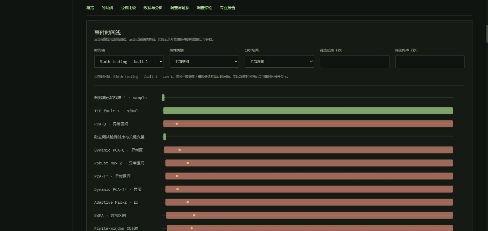

# Tennessee Eastman：独立外部数据案例

L5 可以从缓存的官方 TEP 文件导入独立运行，以正常训练运行拟合和校准九种既有检测器，再通过 Experiment 比较独立测试，进入 Incident 调查并保存离线报告。

## 数据与引用

Rieth, C. A.; Amsel, B. D.; Tran, R.; Cook, M. B. (2017). *Additional Tennessee Eastman Process Simulation Data for Anomaly Detection Evaluation*. Harvard Dataverse, V1. [doi:10.7910/DVN/6C3JR1](https://doi.org/10.7910/DVN/6C3JR1)。这是公开的过程仿真基准，本轮只使用 mode 1。

实际读取了以下原始文件，并同时验证大小、官方 MD5 与 SHA-256：

| 原始文件 | 字节 | SHA-256 |
|---|---:|---|
| TEP_FaultFree_Training.RData | 24,678,017 | `12d1055b852763fac09ef36bd7c9612a800c8bf7b6f75f344d12119206f9e940` |
| TEP_FaultFree_Testing.RData | 47,327,663 | `4f45afafa469793eeb7203fb9ed10ed0b1724c73c9c95537f15a0889ade0ebd4` |
| TEP_Faulty_Testing.RData | 836,882,037 | `c2f1aabc77498efda4d5f9ad81ecc829e2fcd98752b84cf5b2a06558cabacc36` |

官方 `TEP_Faulty_Training.RData` 的身份和 MD5 也在来源清单中，导入器为它保留独立的 1 小时故障起点；本轮实验没有下载或评价该文件。原有 Braatz `.dat` 研究与 THUFDD 多工况研究均保留，本结果不与其协议混合。

输入严格使用 `tep-classic-52-v1`：`xmeas_1…xmeas_41`、`xmv_1…xmv_11`，按原始列名验证和重排。`faultNumber`、`simulationRun`、`sample` 为独立元数据。官方文件未在此适配器中建立工程单位字典，界面保留原始数值单位。

## 时间约定

每个运行保留原始 sample 1…500 或 1…960，并使用 `t=(sample-1)×180 s`。首条观测归一化为 0 s；960 条观测的最后时刻为 172620 s。

- Faulty Testing 的前 160 条观测是注入前正常段；第一条故障观测为 sample 161，即 t=28800 s。
- Faulty Training 的第一条故障观测为 sample 21，即 t=3600 s。
- 正常标签结束于故障前最后一个采样时刻；故障标签从实际首个故障样本开始。不同运行独立存储，彼此的 0 s 不表示同一物理时刻。

每份 Dataset 保存原文件／对象、文件哈希、提取哈希、故障与运行身份、原始列名、导入时间和处理记录。标签保存为独立且不可变的版本，数值矩阵中没有故障编号。

## 固定实验协议

评分前固定的配置在 [protocol.json](../examples/tep/protocol.json)。

| 分区 | 原始来源 | simulationRun | 范围 |
|---|---|---|---|
| Fit | FaultFree Training | 1 | 全部 500 样本，0–89820 s |
| Calibration | FaultFree Training | 2 | 全部 500 样本，0–89820 s |
| 独立正常测试 | FaultFree Testing | 1、2 | 各 960 样本，0–172620 s |
| 独立故障测试 | Faulty Testing，fault 1、3、5 | 各 1、2 | 各 960 样本，含 160 正常与 800 故障样本 |

训练／测试文件中的相同运行号码由原始文件身份区分。数据提供者声明训练与测试使用不重叠的随机种子。Fit 只决定预处理和模型统计量，Calibration 只决定固定分位数阈值；训练代码不读取测试数组。

这里的独立序列指与训练／校准分开的运行边界。公开说明没有据此保证不同故障类型间的八条测试轨迹统计独立；各故障均保留各自两个运行的分布，不给出总体置信区间。

全部 52 通道使用原始观测策略，最低覆盖率 0.9，不额外指定关键必测信号；α=0.01，报警持续条件为 3 个样本。每个算法的同一拟合模型供八个测试运行使用，时序与自适应状态在独立运行及 abstain 边界重启。

| 算法 | 固定参数 |
|---|---|
| Robust Max-Z | 稳健中心／尺度，固定分位数阈值 |
| PCA-Q、PCA-T² | variance=0.9，使用既有最多 20 主成分限制 |
| EWMA | smoothing=0.25 |
| Page CUSUM | reference=0.5 |
| Finite-window CUSUM | reference=0.5，window=12 |
| Dynamic PCA-Q、Dynamic PCA-T² | lags=2，variance=0.9，既有最多 20 主成分限制 |
| Adaptive Max-Z（Experimental） | rate=0.02，guard=2.5，maxShift=1.5 |

## 实际结果

命令行官方案例和真实 Chromium 浏览器分别完成同一协议的 72 项任务，均全部成功。每批只拟合九个模型。所有测试均为完整观测，覆盖率 100%，abstain 为 0。以下为发布的官方案例结果；[完整逐运行结果](../examples/tep/results.json) 保留阈值、全部计数、事件、持续时间、计算时间、输入／代码哈希和失败字段。

| 算法 | 独立正常 FP / 1920 | 故障 1 Recall / 延迟中位数 s | 故障 3 Recall / 检出事件 | 故障 5 Recall / 延迟中位数 s |
|---|---:|---:|---:|---:|
| Robust Max-Z | 0 | 0.988125 / 1710 | 0 / 0/2 | 0.165625 / 2160 |
| PCA-Q | 0 | 0.994375 / 810 | 0 / 0/2 | 0.155625 / 630 |
| PCA-T² | 0 | 0.988750 / 1620 | 0 / 0/2 | 0.205625 / 450 |
| EWMA | 0 | 0.985000 / 2160 | 0 / 0/2 | 0.166875 / 4680 |
| Page CUSUM | 0 | 0.960625 / 5670 | 0 / 0/2 | 0.813750 / 17280 |
| Finite-window CUSUM | 0 | 0.981875 / 2610 | 0 / 0/2 | 0.167500 / 5220 |
| Dynamic PCA-Q | 2 | 0.992500 / 1080 | 0.001250 / 1/2 | 0.198125 / 630 |
| Dynamic PCA-T² | 0 | 0.988125 / 1710 | 0 / 0/2 | 0.201250 / 720 |
| Adaptive Max-Z | 0 | 0.988125 / 1710 | 0 / 0/2 | 0.160625 / 2250 |

每个故障格包含两个运行，共 1600 个注入后样本。延迟只统计已检出的事件；漏检延迟保持未定义。故障 1 和 5 的事件均被九算法各检出 2/2；故障 3 仅 DPCA-Q 在一个运行末段检出，延迟 138780 s，不能据此认为它有效识别了此类故障。

独立正常测试的 DPCA-Q FAR 为 2/1920≈0.1042%，其余为 0/1920。该正常测试分母不包含故障运行中的注入前正常段；完整结果另外保留各故障运行的 160 个正常样本评价。两个正常运行上的实际报警区间和持续时间也单独保存。

这两个正常误报样本都位于正常测试 run 1，同属一个区间，按首末样本时间差计算为 180 s；run 2 没有报警。

## 指标解释

- 样本 TP、FP、TN、FN 仅计算明确标注且非 abstain 的观测。未知时间和 abstain 均不计为正常。Precision=TP/(TP+FP)，Recall=TP/(TP+FN)，F1=2TP/(2TP+FP+FN)，FAR=FP/(FP+TN)。零分母为未定义。
- 事件检出需要真值事件内至少一个报警采样；至少有一个可评价样本的事件才纳入事件检出率。漏检和完全无观测事件分别计数。
- 首次检测延迟是首个事件内报警的实际时间减原始注入时间，单位为秒。本数据为 180 s 的整数倍。
- 覆盖率和 abstain 比例以完整分析样本数为分母。计算时间为实际评分耗时，另保存模型拟合／校准耗时和任务墙钟时间。
- 报警持续时间采用连续区间末时刻减首时刻；单点报警为 0 s。中位数和最小／最大值为本次样本的描述统计，不是置信区间。

## 浏览器与 Incident

真实浏览器从空 Workspace 导入正常运行 1 与故障 1/run 1，核对质量与 52 个输入，并实际渲染到最后一个通道 `xmv_11`。固定案例复用了这两份导入，补齐到十个 Dataset，完成 72 项任务。

矩阵按批次和固定参数条件区分结果；每格保留运行数、失败数、标签评价分母和跨运行分布。选择单一故障／运行可进入既有 ExperimentComparison，查看原始曲线、各算法分数、阈值、贡献和注入标记。AnalysisResult 保留独立来源，单 Dataset 工作流继续可用。

预先指定的 fault 1/run 1 在浏览器中通过九个实际报警区间建立 Incident，保存候选解释、与 PCA-Q 区间关联的支持证据、结论和状态。该运行的 PCA-Q 首次报警为 29520 s，延迟 720 s；Max-Z 为 30600 s，延迟 1800 s。已知故障注入作为独立真值事件出现在时间线中。报告保留实际图表、训练来源、配置和保存的实验评价，说明标签与统计候选解释的区别。

浏览器实际下载的事件 HTML 为 3159299 字节，包含 37 个内嵌 SVG。再次导入同一故障运行后创建了第 11 个 Dataset；随后实际重启服务，原有 92 个 CSV／NPZ／结果文件，以及 72 AnalysisResult、72 任务、实验、九个事件来源和两条调查记录均保持不变。浏览器重新打开后，结论、支持关系和注入时间线正常恢复。[验收记录与哈希](verification/tep-case-study-2026-10-25.json)。

## 资源与平台修复

流式 RDX2 提取器每次读取 65536 行的一列，只保留紧凑故障选择向量和所选运行。对 836882037 字节 Faulty Testing 提取六个完整运行，本机进程峰值驻留内存为 80478208 字节（约 76.8 MiB），墙钟时间 8.221 s，未增加解析依赖。这包含已有 Python／NumPy／pandas 运行时；不同硬件、缓存与网络的时间会不同。

与现有 pyreadr 读取器比较，正常训练运行 1、2 的 1000×52 个数值逐值一致。保留原研究读取器和数值报告校验流程。

实际使用推动了以下修复：CSV 用 round-trip 浮点解析保留导出双精度；实验 worker 为所有训练／测试来源和标签保存快照，跨运行重用拟合；比较与报告按实际测试 Dataset 取来源；映射控件按需展开，避免 52 通道×八运行产生大量隐藏选项；Workspace 保留原生中英文内容，避免浏览器自动翻译造成动态计数显示滞后。

## 复现、验收与边界

获取、准备、启动和导出命令见 [examples/tep/README.md](../examples/tep/README.md)。`examples.tep.verify` 校验实际原始来源、72 项任务、九个固定模型、阈值一致性及指标分母。普通 CI 使用生成的离线格式夹具；大型官方数据通过单独手动工作流验证。

本地最终验证通过 72 项 Workspace Python、40 项模拟 Python、43 项 React DOM、TypeScript 和 Vite 生产构建，另有 115 项研究回归。新增检查覆盖源文件与缓存损坏、52 通道顺序、元数据分离、真实结果协议审计、训练不读测试值、拟合复用、九算法运行边界重置、缺测／采样周期、未知标签分母、快照变化拒绝和历史恢复。

本轮只评价 mode 1、三个故障、每种两个运行。故障 3 的漏检、故障 5 的较低持续 recall 和 CUSUM 的长延迟均保留。下一步应预先定义更多正常训练种子、故障与运行，检查阈值预算的跨种子稳定性、DPCA 边界行为和弱故障可检性；不能用本次故障测试反向调参后继续声称独立验证。

适配器针对已固定的官方 numeric RDX2 data.frame，不提供通用 R 对象导入。TEP 没有接入 TripLens 的 18 通道故障规则，也没有对应物理干预模型；调查使用通用证据与报告能力。独立评分使用原始测试测量，额外扰动需作为明确的派生 Dataset 保存。PDF 沿用现有浏览器 A4 打印流程，本轮保存和验证的是离线 HTML。
