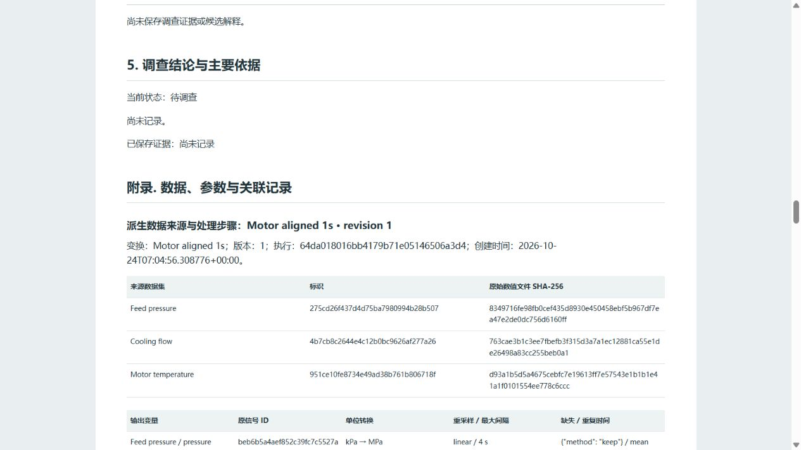

# Transformation pipeline validation

Date: 2026-10-24. Base: main `ccefdb0` (merged PR #18). Feature branch: `codex/data-transformation-pipeline`.

## Three-source acceptance

Used the existing synthetic CSV files in `examples/data-foundation`, with their documented time semantics: ISO temperature, Unix-millisecond flow, and relative pressure explicitly referenced to temperature with +25 seconds. Original files and arrays remain unchanged.

The real HTTP workflow and Chromium UI selected all three stable signal IDs, converted pressure from kPa to MPa, applied linear pressure interpolation with a 4-second maximum bracket, selected finite-mean duplicate handling, held flow values, kept original missing values, and calculated `rate(pressure)`. The computed intersection is **2026-10-24 00:00:25–00:08:40 UTC**, **496 rows**, 1-second cadence. Pressure's first output is **0.3 MPa**. The pressure recording interruption stays missing; stopped-source coverage is preserved.

| Browser execution signal | Valid / 496 | Original coverage | Processing |
|---|---:|---:|---|
| pressure | 431 | 43 | 388 interpolated points; 65 missing |
| flow | 492 | 246 | 246 held points; 4 missing |
| temperature | 495 | 495 | 1 missing |
| pressure_rate | 428 | 14 | MPa/s; 68 missing, including the first point |

The UI saved `Motor aligned 1s`, generated an ordinary Dataset, selected it in Analysis, and used baseline 0–169 / target 170–495 source seconds. With the explicitly selected processed-value policy, Max-Z produced one 60-sample interval at 355–414 seconds (UTC 00:06:20–00:07:19). PCA-Q produced two intervals, including the same 60-sample event. Both analyses abstained on 65 target rows where coverage remained insufficient. The principal interval was added to one persistent Incident from both algorithms. The professional report preview contained actual curves, comparison, original signal IDs, source hashes, unit conversion, maximum gaps, missing/duplicate policies and the rate expression.

## Persistence and versions

The HTTP acceptance suite saves a definition, output, both analyses and Incident, stops the service, starts a new server/store from the same directory and checks exact restored records. It edits the grid to 2 seconds, saves revision 2 and executes again. The new dataset has a distinct ID; prior analyses and Incident links still point at revision 1. SHA-256 of the old generated NPZ and all six source CSV/NPZ files remains unchanged.

The browser acceptance service was also stopped and restarted. The saved configuration reopened with the same source keys, MPa unit and computed 496-row preview. Editing the cadence to 2 seconds created revision 2 with 248 rows; the old Incident still displayed both original analyses and revision 1 provenance.

Saved definitions also keep their resolved relative time references after source-reference edits. A second transformation of a generated source preserves its non-observed mask; exact reads of a prior interpolated value do not become original observations. Generated clocks cannot be independently reassigned. Existing schema and original dataset files remain compatible.

## TripLens integration

The real HTTP test creates and saves a 180-second / 0.5-second TripLens session, converts pressure to MPa on a 1-second grid, calculates pressure rate, runs ordinary Max-Z, links an Incident and restores the session after restart. The generated Dataset retains source simulation IDs; the raw saved simulator Dataset and original session rows are retained. A subsequent sensor-consistency tool run completes in the original session. Existing simulator, investigation and intervention tests run in the same regression suite.

## Numerical and interaction checks

`tests/test_transformations.py` covers affine absolute-temperature conversion, delta scales, industrial units, custom-unit rejection/preservation, explicit rotational semantics, irregular interpolation, nearest/hold, left-closed aggregation, maximum-gap limits, original missing values, outside-coverage boundaries, duplicate policies, fixed/statistical fills, time-zone UTC alignment, millisecond UTC grids without endpoint loss, relative offsets, expression units and parser restrictions, division/domain failures, irregular-time rates, immutable input quantities and lineage/monitoring behavior.

The React DOM tests operate on the actual TSX editor: source selection and ID binding, unit/resampling/duplicate/fill edits, derived expression changes, computed preview display, save/generate, unchanged repeat execution, saved-definition restoration, validation errors, obsolete response rejection, and source/simulation lineage links.

`npm run check` passed: 42 Workspace Python tests, 40 TripLens Python tests, 26 React DOM interaction tests, TypeScript and the Vite production build. Windows local HTTP testing uses `NO_PROXY=127.0.0.1,localhost` and a workspace-local temporary directory, matching CI's proxy exclusion. GitHub Check runs the same commands on Ubuntu and Windows.

## Scope

Version 1 provides one ordered transformation definition with earlier-derived dependencies. Complex dimensional algebra and distributed scheduling remain outside this feature. Complex expression units are declared by the user; numeric multiplication follows displayed input units. Fixed/statistical fills are explicit and retain processed flags; statistical filling uses the entire selected output window. Interpolation and nearest selection may use neighboring source samples outside the target window, within native coverage and the maximum gap. These transformations are preprocessing for the selected analysis purpose and do not establish causal or online-only data availability. PDF output continues through existing browser printing; this feature validates HTML generation and provenance rendering.
